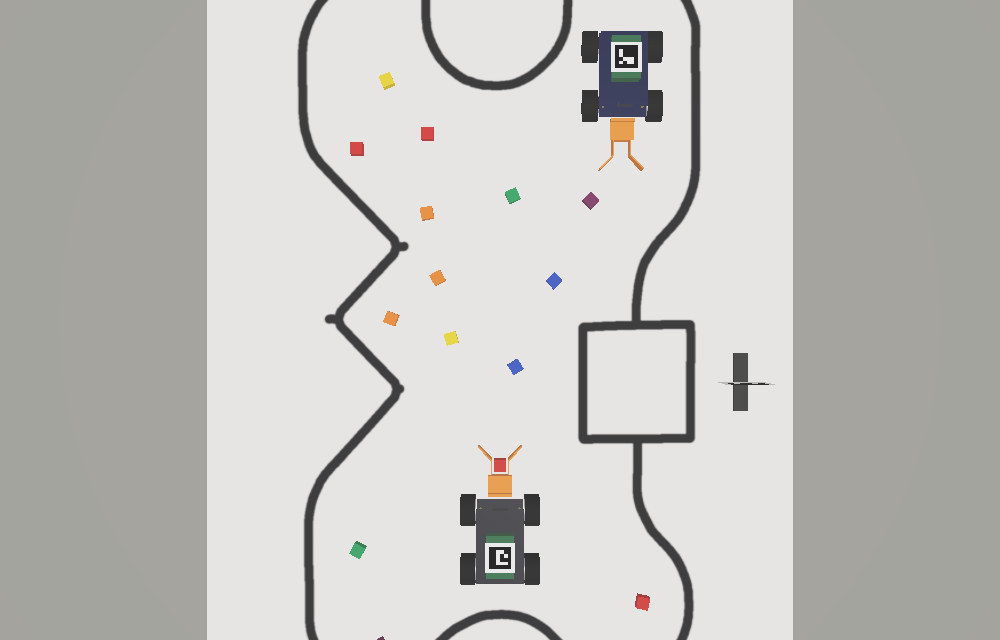
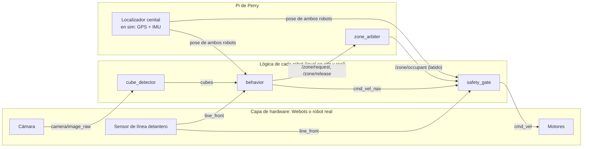

# UCAB Multirobot: Phineas y Ferb (ROS 2 Jazzy + Webots)

Software de los robots recolectores del proyecto de Robótica de la UCAB. Dos robots móviles con ruedas
  mecanum, **Phineas** y **Ferb**, comparten una pista blanca delimitada por una línea negra, buscan cubos
  de 2 x 2 cm de sus colores y los llevan a una zona de transferencia — un cuadrado azul en la pista real
  —, donde el brazo **Perry** los clasifica.

- Phineas recoge cubos **rojos, naranjas y amarillos**; Ferb, **verdes, azules y morados**.
- Los dos robots ejecutan **el mismo código**. Solo cambian su archivo de parámetros
  (`config/phineas.yaml` o `config/ferb.yaml`) y su espacio de nombres (`/phineas` o `/ferb`).
- Los nodos que deciden (visión, comportamiento, seguridad) son idénticos en Webots y en el robot real.
  Lo único que se intercambia es la capa de hardware.



El diseño completo (hardware, pines, decisiones y alternativas) está en
[Phineas_Documento_Tecnico.pdf](Phineas_Documento_Tecnico.pdf). La arquitectura del software está en
[docs/architecture.md](docs/architecture.md) y las tareas pendientes en [docs/team-todo.md](docs/team-todo.md).

## Contenido

- [Estado del proyecto](#estado-del-proyecto)
- [Cómo funciona](#cómo-funciona)
- [Estructura del repositorio](#estructura-del-repositorio)
- [Instalación](#instalación)
- [Ejecutar la simulación](#ejecutar-la-simulación)
- [Pruebas automáticas](#pruebas-automáticas)
- [Robot real](#robot-real)
- [Problemas conocidos y soluciones](#problemas-conocidos-y-soluciones)
- [Lecciones de las pruebas en Webots](#lecciones-de-las-pruebas-en-webots)
- [Cómo contribuir](#cómo-contribuir)

## Estado del proyecto

| Parte | Estado |
|---|---|
| Lógica pura: cinemática mecanum, filtro de seguridad, colores, máquina de estados, llave del cuadro | Implementada, con pruebas |
| Simulación en Webots con los dos robots | **Funciona**: exploran, giran ante el borde, capturan cubos de su color y se esquivan |
| Transporte y entrega del cubo en el cuadro (`CARRY` y `DELIVER`) | **Funciona en Webots** con la captura verificada por la cámara: en la corrida 10, 2 entregas contadas = 2 cubos rojos dentro del cuadro (imagen tomada al soltar cada uno). Los cubos capturados mirando al borde todavía se pierden (tarea 12 de [docs/team-todo.md](docs/team-todo.md)) |
| Cerca virtual (*geofence*) con la pose cenital | Implementada con el polígono de la pista de Webots ([config/track.yaml](src/mobile_base/config/track.yaml)); falta medir la pista real |
| Nodos del robot real (HAT, sensor de línea, cámara) | Escritos; arrancan sin hardware, **sin probar en la Pi 5** |
| Localizador con cámara cenital | Esqueleto y homografía con pruebas; falta la captura real |

## Cómo funciona

### Flujo de datos de un robot



1. **`cube_detector`** convierte la imagen a HSV y busca manchas saturadas con forma de cubo. A cada una
   le asigna un color según su tono. El fondo blanco, la línea negra y la pala gris quedan descartados
   por tener poca saturación.
2. **`behavior`** es una máquina de estados:
   `EXPLORE` (avanza y gira al ver el borde) → `APPROACH` (se orienta hacia el cubo propio más grande)
   → `CAPTURE` (empuja para meterlo en la pala) → `CARRY` (va en arco al punto de entrada del cuadro y
   pide la llave) → `DELIVER` (entra al cuadro, retrocede dejando el cubo y devuelve la llave).
   Publica un comando *deseado*.
3. **`safety_gate`** es el único nodo que escribe en los motores. Recibe el comando deseado y lo recorta
   según las reglas de seguridad. Así ninguna lógica nueva puede saltárselas (patrón *safety filter*).
4. **`zone_arbiter`** (en la Pi de Perry) presta la llave del cuadro con caducidad de 60 s, publica un
   latido a 2 Hz y lleva el conteo oficial de cubos entregados.

### Reglas del filtro de seguridad

| Regla | Por qué |
|---|---|
| Sin latido del árbitro en 2 s → parada | Si se cae la red, ningún robot sigue moviéndose a ciegas |
| Pose propia con más de 0,5 s → parada | La evasión depende de saber dónde están los dos |
| Solo traslación hacia adelante (sin desplazamiento lateral ni reversa) | Hay un único sensor de línea, delantero: moverse de lado o atrás es ciego al borde |
| Línea negra al frente → no avanza, puede girar | No salir de la pista |
| Punto delantero fuera del polígono de la pista (pose cenital) → cuenta como línea; con el centro ya fuera, solo avanza hacia adentro | Un único sensor no distingue el blanco de adentro del de afuera: en Webots el sensor quedó pasado la cinta tras un giro y el robot salió del tablero |
| (comportamiento) La captura cuenta solo si la cámara ve un cubo propio en la ventana entre las paredes de la pala; una entrega cuenta solo si el cubo salió de la pala al retroceder | Empujar 1 s y suponer éxito contó 5 entregas con 1 cubo en el cuadro (corrida 7) |
| Excepción: con la llave del cuadro y dentro del pasillo de entrega, cruza la cinta del cuadro y retrocede a ≤ 0,05 m/s sin cubo | Es la única forma de dejar el cubo con una pala fija; el filtro lo verifica con su propia pose y la llave |
| Otro robot a menos de 0,60 m al frente → frena y gira alejándose; a 0,40 m se detiene | Las palas se tocan a unos 0,38 m entre centros |
| Bloqueo mutuo de más de 3 s → Ferb gira para salir, Phineas espera | Una regla asimétrica evita que los dos cedan a la vez (*livelock*) |
| Con cubo: solo giros en arco; con la línea al frente manda la línea (gira en el sitio y el cubo se pierde) | Girar en el sitio expulsa el cubo de la pala fija, pero salir del tablero es peor (pasó en Webots) |

Detalle y contrato de tópicos en [docs/architecture.md](docs/architecture.md).

### Simulación frente a robot real

| Función | Webots | Robot real |
|---|---|---|
| Motores | plugin `RecolectorDriver` | `hat_motor_driver` (HAT Cokoino, PWM con `lgpio`) |
| Sensor de línea | `DistanceSensor "linea_frente"` | TCRT5000 en GPIO5 |
| Cámara | `Camera "camara"` | IMX219 120° por CSI |
| Posición | GPS + InertialUnit con ruido (imita la cámara cenital) | ArUco cenital (id 1 Phineas, id 2 Ferb) |
| Pala | U fija de 40 × 48 mm, gris | pala impresa en 3D, fija, gris |

## Estructura del repositorio

```text
src/
  multirobot_interfaces/   mensajes y servicios compartidos (RobotPose, RobotState, CubeDetection, zona)
  mobile_base/             código común de Phineas y Ferb
    mobile_base/core/      lógica pura sin ROS: kinematics, safety, colors, behavior, geometry
    mobile_base/vision.py  detección de cubos con OpenCV
    mobile_base/nodes/     nodos ROS 2 (lógica y hardware real)
    config/                phineas.yaml, ferb.yaml (colores, prioridad, umbrales)
    test/                  pruebas de la lógica
  coordinator/             árbitro de la llave del cuadro y conteo oficial
  overhead_localization/   localizador cenital con ArUco y homografía píxel → mesa
  multirobot_sim/          mundo de Webots, protos, plugin RecolectorDriver, URDF, control por teclado
  bringup/                 launch: sim.launch.py, robot.launch.py, robot_logic.launch.py, perry.launch.py
docker/, scripts/          entorno de pruebas con Docker (sin instalar ROS 2 en Windows)
tools/sim_monitor.py       monitor en vivo de los dos robots para depurar corridas
docs/                      arquitectura, tareas pendientes, imágenes
odd/tasks/                 bitácora de la implementación con evidencias de cada paso
figuras/                   figuras del documento técnico
```

`mobile_base/core/` no importa `rclpy`, OpenCV ni `lgpio`: es lógica pura con el tiempo pasado como
argumento. Por eso se prueba con `pytest` en segundos y sin robot. Si el robot hace algo raro, lo primero
es reproducirlo con una prueba de `core/`.

## Instalación

La simulación usa **Webots en Windows** y **ROS 2 dentro de WSL2**. Webots no corre bien dentro de WSL
porque necesita la tarjeta gráfica.

### 1. Webots

Instalar [Webots R2025a](https://cyberbotics.com) en Windows, en la ruta por defecto
`C:\Program Files\Webots`.

### 2. Ubuntu 24.04 en WSL2

En PowerShell como administrador:

```powershell
wsl --install -d Ubuntu-24.04
```

Comprobar con `wsl -l -v` que aparece `Ubuntu-24.04` con `VERSION 2`. La distribución `docker-desktop`
no sirve para esto.

### 3. ROS 2 Jazzy dentro de Ubuntu

Seguir la [guía oficial](https://docs.ros.org/en/jazzy/Installation/Ubuntu-Install-Debs.html) hasta
instalar los paquetes, y luego:

```bash
sudo apt install ros-jazzy-ros-base ros-dev-tools ros-jazzy-webots-ros2 python3-opencv
echo 'source /opt/ros/jazzy/setup.bash' >> ~/.bashrc
echo 'export WEBOTS_HOME=/mnt/c/Program\ Files/Webots' >> ~/.bashrc
source ~/.bashrc
```

### 4. Red entre WSL y Webots

Crear el archivo `C:\Users\<usuario>\.wslconfig` con este contenido y reiniciar WSL con `wsl --shutdown`
desde PowerShell:

```ini
[wsl2]
dnsTunneling=false
```

Sin esto los controladores se quedan en `Cannot connect to Webots instance`. La explicación está en
[Problemas conocidos](#problemas-conocidos-y-soluciones).

### 5. Clonar y compilar

```bash
mkdir -p ~/ws/src && cd ~/ws/src
git clone https://github.com/alejandrovielma/ucab-multirobot.git
cd ~/ws && colcon build --symlink-install
echo 'source ~/ws/install/setup.bash' >> ~/.bashrc && source ~/.bashrc
```

Clonar dentro de Ubuntu (`~/ws`), no en `/mnt/c`: compilar sobre el disco de Windows es lento y rompe
los enlaces simbólicos de `--symlink-install`.

Para actualizar después:

```bash
cd ~/ws/src/ucab-multirobot && git pull && cd ~/ws && colcon build --symlink-install
```

## Ejecutar la simulación

Con Webots **cerrado** (el launch lo abre solo):

```bash
ros2 launch bringup sim.launch.py
```

El launch abre Webots, conecta los dos robots (`controller "<extern>"`) con el plugin `RecolectorDriver`,
inicia `Ros2Supervisor` (que publica el reloj `/clock` de la simulación), la lógica de cada robot y el
árbitro. Al cerrar Webots se cierra todo.

### Ver qué está pasando

En otra terminal de Ubuntu:

```bash
ros2 topic echo /phineas/state                     # estado de la máquina de estados
ros2 topic echo /phineas/cubes                     # cubos detectados por la cámara
python3 ~/ws/src/ucab-multirobot/tools/sim_monitor.py --duration 120 --out /tmp/monitor --frames-every 10
```

El monitor imprime cada medio segundo el estado, la pose, el comando a los motores, la línea, el cubo
objetivo de cada robot y la distancia entre ellos. Con `--frames-every` guarda además imágenes de la
cámara de Phineas. Es la forma más rápida de diagnosticar un comportamiento extraño.

### Pruebas manuales

Solo Webots y los drivers, sin la lógica, para mover un robot a mano:

```bash
ros2 launch bringup sim.launch.py logic:=false
ros2 topic pub --rate 10 /phineas/cmd_vel geometry_msgs/msg/Twist "{linear: {x: 0.1}}"
```

Control por teclado sin ROS: abrir `src/multirobot_sim/worlds/pista_ucab.wbt` en Webots y cambiar el
campo `controller` del robot a `recolector_teleop` (y el del otro a `<none>`). Teclas: W/S avanzar y
retroceder, A/D lateral, Q/E girar, +/− velocidad. **No guardar el mundo** al cerrar: el launch necesita
los dos robots en `<extern>` (hay una prueba automática que lo verifica).

## Pruebas automáticas

Requisito: Docker Desktop encendido. No hace falta ROS 2 en Windows.

```powershell
powershell -File scripts/test_in_docker.ps1          # construye la imagen y corre todo
powershell -File scripts/test_in_docker.ps1 -NoBuild # reutiliza la imagen
```

El script compila los 6 paquetes, ejecuta `colcon test` (99 pruebas), importa cada módulo y arranca
`robot.launch.py` de Phineas y Ferb sin hardware para comprobar que ningún nodo se cae. Desde Ubuntu
también se puede correr `colcon test` directamente en `~/ws`.

## Robot real

> **Pruebas de laboratorio sin ROS:** para probar motores, sensor de línea, cámara y la persecución de
> cubos en la Pi 5 sin instalar ROS, seguir [docs/guia-pruebas-laboratorio.md](docs/guia-pruebas-laboratorio.md)
> (procedimiento paso a paso) y [tools/lab/README.md](tools/lab/README.md) (la herramienta).

En la Pi 5 de cada robot (Ubuntu 24.04, ROS 2 Jazzy y `python3-lgpio`):

```bash
ros2 launch bringup robot.launch.py robot:=phineas   # o robot:=ferb
```

En la Pi de Perry (árbitro y cámara cenital):

```bash
ros2 launch bringup perry.launch.py
```

- Las tres Pi deben estar en la misma red, con el mismo `ROS_DOMAIN_ID` y los relojes sincronizados
  (chrony): el filtro de seguridad descarta poses con más de 0,5 s de antigüedad.
- Por seguridad el robot **no se mueve** sin pose cenital ni latido del árbitro. Para una prueba en banco
  sin ellos: `robot.launch.py robot:=phineas require_pose:=false require_heartbeat:=false`.
- Hardware: Raspberry Pi 5, HAT Cokoino 4WD (2 × DRV8833), 4 motores TT 1:120 con ruedas mecanum,
  cámara IMX219 de 120°, un sensor de línea delantero y pala fija impresa en 3D. Usar **solo batería 2S**:
  el DRV8833 admite como máximo 11,8 V. Pines en [docs/architecture.md](docs/architecture.md).

## Problemas conocidos y soluciones

| Síntoma | Causa | Solución |
|---|---|---|
| `fatal: detected dubious ownership` al clonar desde `/mnt/c` | Git rechaza repositorios cuyo dueño es otro usuario (los archivos de Windows aparecen así desde WSL) | `git config --global --add safe.directory <ruta>/.git` |
| `Cannot connect to Webots instance` en bucle | Con *DNS tunneling*, `/etc/resolv.conf` apunta a `10.255.255.254` y `webots_ros2` usa esa IP como la de Windows ([webots_ros2#1031](https://github.com/cyberbotics/webots_ros2/issues/1031)) | `.wslconfig` con `dnsTunneling=false` y `wsl --shutdown` |
| `ValueError: NULL pointer access` en `getImage()` | La cámara de Webots aún no tiene imagen en los primeros pasos | Corregido en el driver (`read_camera_image`) |
| Los robots no se mueven y no hay errores | Sin `/clock`, los nodos con tiempo de simulación no avanzan | Corregido: `sim.launch.py` inicia `Ros2Supervisor` |
| La cámara publica a ~6 Hz | Las imágenes viajan por la red entre Windows y WSL | No afecta la lógica: todo corre en tiempo de simulación |
| Aviso `PointLight ... attenuation` en Webots | Iluminación del mundo | Inofensivo |

## Lecciones de las pruebas en Webots

Errores que solo aparecieron al correr la simulación completa, y cómo se resolvieron:

1. **La pala fija suelta el cubo al girar en el sitio.** Comprobado con el teclado: en arco el cubo se
   mantiene, en el sitio sale a unos 45°. Solución: con cubo, solo giros en arco, y la U se hizo más
   profunda (48 mm).
2. **Phineas perseguía su propia pala.** Las alas naranjas aparecían en la cámara y el detector las tomaba
   por un cubo naranja. Solución: pala gris (en Webots y en la impresión real), con una prueba que impide
   volver a pintarla de un color de cubo.
3. **El esquive lateral sacaba a los robots de la pista.** Con un solo sensor delantero, moverse de lado
   es ciego. Solución: solo avanzar o girar; para esquivar, frenar y girar alejándose.
4. **Los robots se tocaban.** La distancia de parada no contaba el largo de la pala. Solución: 0,40 m.

El registro completo con evidencias está en [odd/tasks/phineas-repo-base.md](odd/tasks/phineas-repo-base.md).

## Cómo contribuir

- Trabajar en una rama (`feat/...`, `fix/...`) y abrir un *pull request* hacia `main`.
- Mensajes de commit con el formato `tipo(área): qué cambió`, por ejemplo `fix(safety): ...`.
- Toda lógica nueva va en `core/` con su prueba, y se valida primero en Webots y después en la pista.
- Antes de subir: `powershell -File scripts/test_in_docker.ps1 -NoBuild` debe terminar en
  `all checks passed`.
- Las tareas pendientes, con criterios de aceptación, están en [docs/team-todo.md](docs/team-todo.md).
  Las siguientes están en [docs/team-todo.md](docs/team-todo.md).
