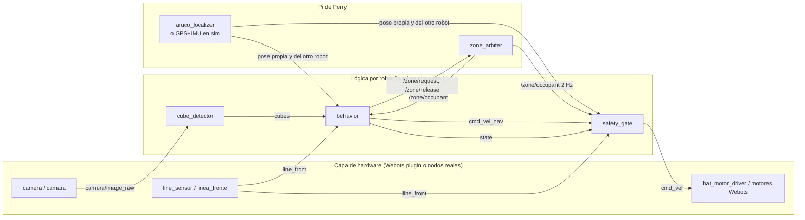

# Arquitectura

## Flujo de datos

Cada robot vive en su espacio de nombres (`/phineas` o `/ferb`). La lógica produce un comando
**deseado** (`cmd_vel_nav`); el `safety_gate` es el único que publica el comando que llega a los
motores (`cmd_vel`). Así ninguna lógica nueva (por ejemplo la entrega) puede saltarse las reglas de
seguridad.

## Contrato de tópicos

Espacio de nombres `/<robot>`, con robot en {phineas, ferb}:

| Tópico | Tipo | Productor (sim / real) | Consumidor |
|---|---|---|---|
| `camera/image_raw` | sensor_msgs/Image | plugin de Webots / camera_node | cube_detector |
| `line_front` | std_msgs/Bool (true = línea negra) | plugin de Webots / line_sensor_node | safety_gate, behavior |
| `pose` | multirobot_interfaces/RobotPose | plugin de Webots (GPS+InertialUnit, emula la cámara cenital) / overhead_localization | behavior, safety_gate de ambos robots |
| `cmd_vel` | geometry_msgs/Twist | safety_gate | plugin de Webots / hat_motor_driver |
| `cmd_vel_nav` | geometry_msgs/Twist | behavior | safety_gate |
| `cubes` | multirobot_interfaces/CubeDetectionArray | cube_detector | behavior |
| `state` | multirobot_interfaces/RobotState | behavior | coordinador, el otro robot (y safety_gate para saber si carga un cubo) |
| `/zone/occupant` | std_msgs/String (latido 2 Hz, transient local; vacío = libre) | coordinador | behavior, safety_gate |
| `/zone/request`, `/zone/release` | servicios | coordinador | behavior |

Convenciones: `vx` hacia adelante, `vy` positivo a la izquierda, `wz` positivo antihorario; ruedas en
orden FL, FR, RL, RR. El marco de la mesa en simulación es el marco del mundo de Webots (origen en el
centro del tablero, x a lo largo del lado de 1,93 m).

## Qué corre dónde

| Máquina | Nodos | Launch |
|---|---|---|
| Pi 5 de Phineas | hat_motor_driver, line_sensor, camera, cube_detector, behavior, safety_gate (`/phineas`) | `robot.launch.py robot:=phineas` |
| Pi 5 de Ferb | los mismos nodos en `/ferb` | `robot.launch.py robot:=ferb` |
| Pi de Perry | zone_arbiter (coordinador), aruco_localizer (cámara cenital) | `perry.launch.py` |
| PC (simulación) | Webots + 2 plugins + lógica de ambos robots + coordinador | `sim.launch.py` |

## Simulación frente a robot real

Solo cambia la capa de hardware; `robot_logic.launch.py` se incluye igual en los dos casos.

| Función | Simulación | Robot real |
|---|---|---|
| Motores | `RecolectorDriver` usa `mobile_base.core.kinematics` y fija velocidades en `motor_*` (máx. 10,5 rad/s) | `hat_motor_driver`: misma cinemática, tope de duty 6 V / V_bat, PWM por `lgpio` en los pines IN del HAT, *watchdog* de 300 ms |
| Sensor de línea | `DistanceSensor "linea_frente"`, negro si el valor < `line_threshold` | TCRT5000 digital en GPIO5 |
| Cámara | `Camera "camara"` publicada en `bgra8` | `camera_node` (OpenCV; pendiente validar CSI en Ubuntu) |
| Pose | GPS + InertialUnit con ruido gaussiano opcional | ArUco cenital (DICT_4X4_50, id 1 Phineas, id 2 Ferb) |
| Pala | `servo_pala` fijo en 0 | pala impresa fija, sin servo |

## Reglas de seguridad (`safety_gate`)

En este orden, en cada ciclo de 20 Hz:

1. Sin latido de `/zone/occupant` durante más de 2 s: parada total.
2. Pose propia con más de 0,5 s de antigüedad: parada total.
3. Solo traslación hacia adelante: se eliminan `vy` y `vx` negativo. El robot tiene un único sensor
   de línea delantero, así que desplazarse de lado o retroceder es ciego al borde (en Webots, el
   esquive lateral sacó a los dos robots del tablero). Girar en el sitio sí está permitido.
4. Línea negra al frente: se anula el avance; girar sigue permitido.
5. Otro robot dentro de un cono frontal de 60°: frena linealmente entre 0,60 m y 0,40 m, se detiene
   por debajo de 0,40 m (las palas se tocan a unos 0,38 m entre centros) y gira alejándose de él.
   Si los dos quedan bloqueados de frente más de 3 s, el robot **sin prioridad** (Ferb) gira 1,5 s
   para salir; si lleva un cubo se queda quieto, porque cualquier maniobra lo sacaría de la pala.
6. Con cubo en la pala: solo giros en arco (avance mínimo 0,05 m/s, giro máximo 0,6 rad/s). Girar en
   el sitio expulsa el cubo de la pala fija (comprobado en Webots).

## Pines del HAT Cokoino (BCM)

| Señal | Pin | Motor |
|---|---|---|
| nSLEEP | 12, 13 (en alto) | ambos DRV8833 |
| DRV#1 AIN1 / AIN2 | 17 / 27 | M1 delantero izquierdo |
| DRV#1 BIN1 / BIN2 | 22 / 23 | M2 trasero izquierdo |
| DRV#2 AIN1 / AIN2 | 24 / 25 | M3 delantero derecho |
| DRV#2 BIN1 / BIN2 | 26 / 16 | M4 trasero derecho |

Decaimiento rápido: PWM en xIN1 con xIN2 en bajo = adelante; al revés para retroceder.
