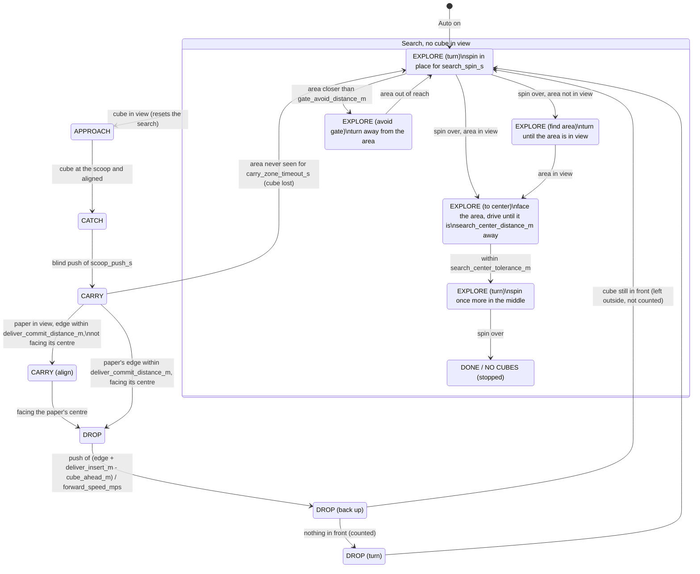

# Auto mode: search and delivery states

Scope: the browser tool's Auto mode (`tools/teleop_web_lib/autopilot.py`).
Parameters are in the `auto` section of `tools/teleop_web.yaml`; the names
below are those keys.

The robot has no wheel encoders and does not use Perry's pose here. Its only
landmark is the delivery area: the two legos from afar (`gate`) and the blue +
pink paper up close (`floor`). "The middle of the arena" means
`search_center_distance_m` from the area, which is the arena's centre when the
area sits in the middle of one side.

## State diagram

The black line overrides every state except the ones listed under "Line" in
the table: brake, move away from it, turn inward, then resume.

## Situations and responses

| Situation | Response | Why |
|---|---|---|
| **Searching** | | |
| Auto turned on, no cube in view | Spin in place for `search_spin_s` (about one turn at `search_turn_speed`) | A cube anywhere in view range is found without moving |
| A cube appears at any point of the search | Go for it; the search restarts from a spin afterwards | |
| Spin over, the area in view | Face the area and drive (or back up) until it is `search_center_distance_m` away, then spin again | From the middle every cube is within the camera's range |
| Spin over, the area not in view | Keep turning until it shows up | It is the only landmark to find the middle with |
| Already at the middle when the first spin ends | That spin counts as the one in the middle | |
| Spin in the middle over, no cube | Stop: `DONE (n delivered)` or `NO CUBES (stopped)` | Two spins (one in the middle) covered the arena |
| Searching longer than `no_cubes_stop_s` | Stop | Hard limit (the area never found, a loop) |
| During a spin, the area or its legos closer than `gate_avoid_distance_m` | Turn away from it, keep the scan turning that way | Roaming there ran the robot over the legos |
| A cube seen, then lost | Wait `lost_timeout_s`; keep heading where it was for `reacquire_s`; if it was close, back up `reveal_backup_s` (it may be under the scoop) | |
| **Carrying** | | |
| Only the legos in view | Drive toward their midpoint, slowing below `zone_stop_distance_m`; never push from there | A push started from the legos left the cube 20 cm short |
| The paper in view, far | Steer toward the paper's centre (bearing of its outline projected on the floor) | Its image centre is not its floor centre |
| The paper's near edge within `deliver_commit_distance_m` (or at row `floor_arrive_v_px`) | Turn in place until facing its centre (`drop_align_tolerance_rad`), then push | |
| Push | Straight, blind, for (edge + `deliver_insert_m` − `cube_ahead_m`) / `forward_speed_mps`; also from a diagonal | The near edge's distance is precise; the far edge's is not |
| Nothing in view for `carry_zone_timeout_s` | The cube slipped out: search again | |
| **After a delivery** | | |
| Backed up and a cube is within `drop_verify_distance_m` | The delivery does not count; go for that cube | A cube left at the area's edge was counted twice |
| Backed up, nothing in front | Counted; turn, then search | Cubes inside the area are filtered out by vision |
| **Line** | | |
| Black line while searching or going for a cube | Line recovery; cubes are ignored for `line_cube_ban_s` if it was chasing one | That cube is at the border |
| Black line while carrying, paper not close | Line recovery; the cube is left behind | It was pushed over the border |
| Black line while carrying with the paper within `carry_line_ignore_distance_m`, or during the delivery | Ignored: keep going | It is the area's own tape or the border next to its entry; turning back made the robot curve around instead of going straight in |
| A single black read | Ignored (`line_sensor.confirm_reads`) | The sensor lifting off the table while moving |

## Open points

- `search_spin_s`, `search_center_distance_m`, `deliver_insert_m` and
  `forward_speed_mps` are estimates (TODO measure in `tools/teleop_web.yaml`).
- The middle is found only along the line from the robot to the area: the
  robot ends somewhere at that distance from the area, not necessarily on the
  arena's axis.
- A false "paper" on the arena's border tape (it reads blue at some angles)
  can still draw the robot there.

## Ferb's FSM (`mobile_base/collector.py`): stall fixes

Two local robustness features ported as ideas (not code) from `core/behavior.py`:

- **Missed-catch memory.** `capture_fails` (2) misses inside `capture_fail_window_s`
  (20 s) put the target's colour on an ignore list for `skip_time_s` (3 s);
  `_search` filters those cubes out. It is per colour because a cube has only
  bearing and distance (no pose), so it has no identity. A verified catch
  clears the miss count.
- **Stuck-line watchdog.** More than `line_stuck_escapes` (4) LINE_ESCAPE starts
  inside `line_stuck_window_s` (30 s) stops the robot (zero command, no new
  escape) and sets `CollectorFsm.line_stuck`, reported as `line_stuck` on
  `behavior/state`. It resumes (`_idle_state`) after the sensor reads white
  for `line_stuck_clear_s` (1 s) without a black read in between.
