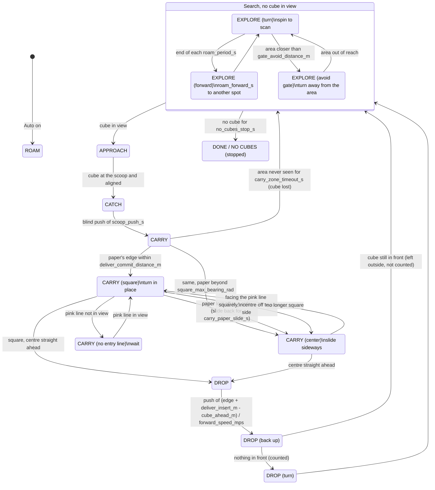

# Auto mode: search and delivery states

Scope: the browser tool's Auto mode (`tools/teleop_web_lib/autopilot.py`).
Parameters are in the `auto` section of `tools/teleop_web.yaml`; the names
below are those keys.

The robot has no wheel encoders and does not use Perry's pose here. Its only
landmark is the delivery area: the two legos from afar (`gate`) and the blue
paper with the pink entry line up close (`floor`). The cube is always pushed
in head-on across the pink line.

## State diagram

The black line overrides every state: brake, move away from it, turn inward,
then resume.

## Situations and responses

| Situation | Response | Why |
|---|---|---|
| **Searching** | | |
| No cube in view | Turn to scan at `search_turn_speed`, then drive forward `roam_forward_s` at the end of every `roam_period_s` | A spin that saw nothing is not the whole arena |
| A cube appears | Go for it | |
| No cube seen for `no_cubes_stop_s` (since the start, the last cube or the last delivery) | Stop: `DONE (n delivered)` or `NO CUBES (stopped)` | |
| The area or its legos closer than `gate_avoid_distance_m` | Turn away from it, keep the scan turning that way | Roaming there ran the robot over the legos |
| A cube seen, then lost | Wait `lost_timeout_s`; keep heading where it was for `reacquire_s`; if it was close, back up `reveal_backup_s` (it may be under the scoop) | |
| A cube of `camera.avoid_colors` (the other robot's) closer than `foreign_avoid_distance_m` and within `foreign_clearance_m` of the straight path, while driving forward (searching or carrying) | Slide sideways away from it (Mecanum keeps the heading) until it is `foreign_exit_margin_m` farther out | It is never a target and never delivered, but a forward move would push it. The blind catch push and the delivery push are not interrupted |
| **Carrying** | | |
| Only the legos in view | Drive toward their midpoint, slowing below `zone_stop_distance_m`; never push from there | A push started from the legos left the cube 20 cm short |
| The paper in view, far | Steer toward the paper's centre | |
| The paper's near edge within `deliver_commit_distance_m` (or at row `floor_arrive_v_px`) | Turn in place until facing the pink line squarely (`entry_square_tolerance_rad`) | A crooked push knocks the legos down |
| At the paper, arriving diagonally: its centre beyond `square_max_bearing_rad`, or the pink line not in view | Slide toward it at `strafe_speed` before turning | Turning in place pushed the paper out of view and the robot alternated squaring up and turning to the legos for over a minute |
| Squaring up, the paper drops out of view | Wait `carry_paper_hold_s`; if it was last seen off to a side, slide that way for up to `carry_paper_slide_s`; then steer by the legos | |
| Square, the paper's centre off to a side | Slide sideways at `strafe_speed` (heading kept) until it is within `drop_align_tolerance_rad` | Enter in front of the centre, not on a diagonal |
| The pink line not in view at the paper | Wait (`CARRY (no entry line)`) | Better stopped than pushing crooked |
| Push | Straight, blind, for (edge + `deliver_insert_m` − `cube_ahead_m`) / `forward_speed_mps` | The near edge's distance is precise; the far edge's is not |
| Nothing in view for `carry_zone_timeout_s` | The cube slipped out: search again | |
| **After a delivery** | | |
| Backed up and a cube is within `drop_verify_distance_m` | The delivery does not count; go for that cube | A cube left at the area's edge was counted twice |
| Backed up, nothing in front | Counted; turn, then search | Cubes inside the area are filtered out by vision |
| **Line** | | |
| Black line while searching or going for a cube | Line recovery; cubes are ignored for `line_cube_ban_s` if it was chasing one | That cube is at the border |
| Black line while carrying | Line recovery; the cube is left behind | It was pushed over the border |
| Black line during the delivery push | Line recovery; the cube counts as delivered | It is the area's back tape |
| A single black read | Ignored (`line_sensor.confirm_reads`) | The sensor lifting off the table while moving |

## Open points

- `entry_square_tolerance_rad`, `strafe_speed`, `deliver_insert_m` and
  `forward_speed_mps` are estimates (TODO measure in `tools/teleop_web.yaml`).
- The pink line must be found at `deliver_commit_distance_m` under the lab
  light (`camera.area_hsv.area_pink`); an earlier squared entry missed it at
  30 cm, before the two-range pink.
- A false "paper" on the arena's border tape (it reads blue at some angles)
  can still draw the robot there.
