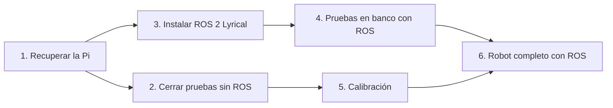
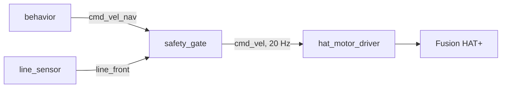

# Guía: qué hacer a partir de ahora

Actualizada: 2026-10-23. Orden de trabajo para Phineas después del primer laboratorio. Cada parte dice
cuándo está terminada. Estado general y tareas del equipo: [estado-y-proximos-pasos.md](estado-y-proximos-pasos.md).



Las partes 2 y 3 son independientes: se pueden hacer el mismo día, en ese orden o al revés.

---

## 1. Recuperar la Pi

La última sesión terminó con el SSH en `Connection timed out`.

1. **Medir la batería** con el multímetro. Por debajo de unos 7 V, cargarla antes de seguir: es la
   causa más probable del corte (motores y cámara funcionando a la vez).
2. **Reiniciar:** mantener presionado el botón de encendido de la Pi 5 hasta que se apague el LED
   (apagado forzado) y presionarlo una vez para encender. Desconectar la batería solo si el botón no
   responde (riesgo de dañar la tarjeta SD).
3. **Encontrar la Pi en la red:** `ping 10.68.17.41` desde la laptop. Si no responde, conectarle
   monitor y teclado y ver la IP con `hostname -I` (la red puede haberle dado otra).
4. **Entrar y actualizar:**
   ```bash
   cd ~/ucab-multirobot && git pull
   ```

**Terminada si:** `git log -1` muestra el commit `fix(tools): camera check survives a missing /proc...`
o uno posterior.

**Regla desde ahora:** si el SSH se corta con algo corriendo (cámara, motores), al volver a entrar
ejecutar `ps aux | grep lab_robot | grep -v grep` y terminar lo que siga vivo con `kill <PID>`.

---

## 2. Cerrar las pruebas sin ROS

Con `tools/lab/lab_robot.py`, como el 2026-10-20. Lista completa en [lab-hoy.md](lab-hoy.md).
**Guardar siempre la consola** agregando `2>&1 | tee <nombre>.log` al comando.

| Prueba | Comando | Qué anotar |
|---|---|---|
| Cámara (bloque D) | `python3 tools/lab/lab_robot.py camera --save-every 5 2>&1 \| tee camara.log` | Cada color a 20/40/60 cm: nombre, `cy` y área; rojo y morado juntos; tablero vacío |
| Cuadro azul con la cámara | Mismo comando, robot frente al cuadro a 30 y 10 cm | ¿Dice `cuadro azul (...)`? |
| Sensor sobre el cuadro azul | `python3 tools/lab/lab_robot.py line` | ¿`blanco` o `NEGRO`? |
| Pala (bloque E) | `python3 tools/lab/lab_robot.py drive --battery <V> --max-speed 0.08` | Con un cubo: `w` recto, `u`/`o` arcos, `q`/`e` giro, `s` atrás: ¿lo conserva? |
| Manejo (bloque F) | El mismo `drive` | Desviación al avanzar 1 m; tiempo de una vuelta con `q` |
| Persecución (bloque G) | `python3 tools/lab/lab_robot.py chase --battery <V> --max-speed 0.08 2>&1 \| tee chase.log` | 5 intentos: ¿llega al cubo y se detiene? ¿Retrocede al ver la cinta? |

**Terminada si:** la tabla está llena y se trajeron `capturas/` y los `.log`.

Si la cámara falla con `camera in use by PID ...`: `kill <PID>` con ese número, o `sudo reboot`.

---

## 3. Instalar ROS 2 Lyrical en la Pi

Comandos de la guía oficial de instalación en Ubuntu, rama `lyrical` de
[ros2_documentation](https://github.com/ros2/ros2_documentation/blob/lyrical/source/Get-Started/Installation/Ubuntu-Install-Debs.rst).
Es una instalación con `apt`, sin Docker. Tarda: dejar la Pi conectada al cargador o con la batería
llena.

### 3.1 Idioma del sistema (UTF-8)

```bash
locale
sudo apt update && sudo apt install -y locales
sudo locale-gen en_US en_US.UTF-8
sudo update-locale LC_ALL=en_US.UTF-8 LANG=en_US.UTF-8
export LANG=en_US.UTF-8
```

### 3.2 Repositorio de ROS 2

```bash
sudo apt install -y software-properties-common
sudo add-apt-repository universe
sudo apt update && sudo apt install -y curl
export ROS_APT_SOURCE_VERSION=$(curl -s https://api.github.com/repos/ros-infrastructure/ros-apt-source/releases/latest | grep -F "tag_name" | awk -F'"' '{print $4}')
curl -L -o /tmp/ros2-apt-source.deb "https://github.com/ros-infrastructure/ros-apt-source/releases/download/${ROS_APT_SOURCE_VERSION}/ros2-apt-source_${ROS_APT_SOURCE_VERSION}.$(. /etc/os-release && echo ${UBUNTU_CODENAME:-${VERSION_CODENAME}})_all.deb"
sudo dpkg -i /tmp/ros2-apt-source.deb
```

Si `curl` a `api.github.com` falla por la red del laboratorio, `ROS_APT_SOURCE_VERSION` queda vacío y
el segundo `curl` baja un archivo inválido: comprobar con `echo $ROS_APT_SOURCE_VERSION` antes del
`dpkg`.

### 3.3 ROS 2 Lyrical (sin interfaz gráfica)

La guía oficial pide el sistema actualizado antes de instalar:

```bash
sudo apt update && sudo apt upgrade
sudo apt install -y ros-lyrical-ros-base ros-dev-tools
echo 'source /opt/ros/lyrical/setup.bash' >> ~/.bashrc
source ~/.bashrc
```

`ros-base` (sin RViz ni demos) es la variante para un robot sin pantalla. **Ojo con el `apt upgrade`:**
si actualiza el kernel, Ubuntu reemplaza `/boot/firmware/current/` y se pierde el overlay de la
Fusion HAT+. Después del reinicio, si `lsmod | grep fusion_hat` sale vacío, repetir el paso 4 de la
[guía 4.3](guia-pruebas-laboratorio.md#43-driver-de-la-fusion-hat) (copiar el `.dtbo`) y reiniciar.

### 3.4 Compilar el repositorio

```bash
cd ~/ucab-multirobot
colcon build --symlink-install
echo 'source ~/ucab-multirobot/install/setup.bash' >> ~/.bashrc
source ~/.bashrc
```

**Terminada si:** `colcon build` termina con `6 packages finished` sin errores y
`ros2 pkg list | grep mobile_base` muestra el paquete.

---

## 4. Pruebas en banco con ROS (robot levantado, ruedas en el aire)

Cómo circulan los comandos en el robot (lo que se prueba aquí, de abajo hacia arriba):



### 4.1 Solo el driver de motores

Sin el resto de los nodos, para que nadie más publique en `cmd_vel`. Terminal 1:

```bash
ros2 run mobile_base hat_motor_driver --ros-args -r __ns:=/phineas --params-file ~/ucab-multirobot/install/mobile_base/share/mobile_base/config/phineas.yaml
```

Debe imprimir `backend fusion_hat, duty cap ... dry run False`. Terminal 2 (cada comando, `Ctrl+C`
para detenerlo):

```bash
ros2 topic pub --rate 10 /phineas/cmd_vel geometry_msgs/msg/Twist "{linear: {x: 0.08}}"
ros2 topic pub --rate 10 /phineas/cmd_vel geometry_msgs/msg/Twist "{linear: {y: 0.08}}"
ros2 topic pub --rate 10 /phineas/cmd_vel geometry_msgs/msg/Twist "{angular: {z: 0.8}}"
```

- [ ] Avanzar, lateral izquierda y giro antihorario como en la prueba de `motors`.
- [ ] **Watchdog:** al detener el `pub` (`Ctrl+C`), las ruedas paran en menos de medio segundo y el
      driver escribe `cmd_vel watchdog: stopping motors` (`watchdog_timeout: 0.3` s).

Hay que publicar a 10 Hz o más: un `--once` lo detiene el watchdog a los 0,3 s.

### 4.2 Solo el sensor de línea

```bash
ros2 run mobile_base line_sensor --ros-args -r __ns:=/phineas --params-file ~/ucab-multirobot/install/mobile_base/share/mobile_base/config/phineas.yaml
ros2 topic echo /phineas/line_front
```

- [ ] `data: false` sobre blanco y `data: true` sobre la cinta.

### 4.3 Todo el robot, sin cámara cenital ni coordinador

```bash
ros2 launch bringup robot.launch.py robot:=phineas require_pose:=false require_heartbeat:=false
```

Arranca motores, sensor, cámara, detector de cubos, comportamiento y filtro de seguridad.

- [ ] Ningún nodo muere al arrancar (`process has died` en la salida).
- [ ] `ros2 topic hz /phineas/cmd_vel` muestra unos 20 Hz.

**Limitación conocida:** el nodo de la cámara de ROS (`camera_node.py`) usa `cv2.VideoCapture(0)`, que
no recibe imágenes de la cámara CSI de la Pi 5 (la herramienta del laboratorio sí, porque usa
libcamera). Es esperable ver `cannot open camera` o `camera read failed`: anotar el mensaje exacto. Se
corrige en el código antes de la parte 6. Sin imágenes el robot explora pero no ve cubos.

**Terminada si:** 4.1 y 4.2 pasan, y en 4.3 solo falla la cámara.

---

## 5. Calibración (lo hace quien lleva el software)

Con los datos de la parte 2: `capture_cy` y ventana de la pala, `min_area` y `square_min_area`, rangos
de color. Se suben a `main` y en la Pi basta con `git pull` (y `colcon build` si ya está ROS).

## 6. Robot completo con ROS

Cuando el nodo de la cámara funcione en la Pi y esté la calibración: repetir la persecución del bloque G
con `robot.launch.py` en vez de `lab_robot.py chase`. La entrega en el cuadro azul necesita además la
cámara cenital (pose de cada robot).

## Qué mandar después de cada jornada

1. Los `.log` y la carpeta `capturas/`.
2. Las casillas marcadas de esta guía (una foto sirve).
3. Cualquier error, completo (desde la primera línea del mensaje).
