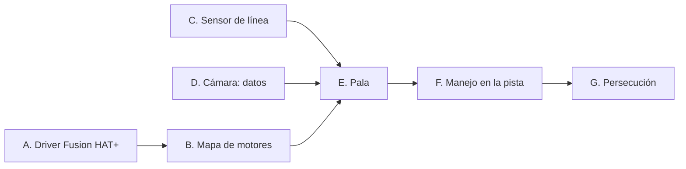

# Laboratorio de hoy (2026-10-20): lista de trabajo

> **Resultado de la jornada:** A, B y C aprobados en Phineas; D parcial (detecta cubos, quedó un error
> por reportar); E, F y G pendientes. Resumen y próximos pasos en
> [estado-y-proximos-pasos.md](estado-y-proximos-pasos.md).

Versión corta y actualizada del [plan de pruebas por fases](plan-pruebas-robot-real.md): solo lo que
falta. Los comandos detallados están en la [guía del laboratorio](guia-pruebas-laboratorio.md).
Todo se hace con `tools/lab/lab_robot.py`, **sin ROS**.

## Ya hecho (no repetir)

- [x] Pi 5 con Ubuntu Server 26.04 y la cámara IMX219 funcionando.
- [x] Robot montado: Fusion HAT+, 4 motores conectados, pala, cámara, sensor de línea (sin cablear).
- [x] Código para la Fusion HAT+ y la pista medida, ya en `main`.

## 1. Al llegar: la Pi con el código de hoy

```bash
cd ~/ucab-multirobot && git checkout main && git pull
```

Si la Pi todavía no tiene el repositorio, clonarlo con un token de GitHub
([guía 4.5](guia-pruebas-laboratorio.md#45-descargar-el-código)). Si faltan paquetes, instalar los de la
[guía 4.2](guia-pruebas-laboratorio.md#42-instalar-lo-necesario). Comprobación en seco, sin mover nada:

```bash
python3 tools/lab/lab_robot.py motors --dry-run --seconds 0.1
```

- [ ] Sin errores y `git log -1` muestra `Merge pull request #3`.
- [ ] Batería medida con el multímetro (7,4–8,4 V): ______ V. Ese valor va en `--battery`.

## 2. Bloques de hoy

Los bloques A, C y D no dependen entre sí: si A se traba, otra persona sigue con C y D.



### A. Driver de la Fusion HAT+ (lo primero: sin esto los motores no se mueven)

Pasos de la [guía 4.3](guia-pruebas-laboratorio.md#43-driver-de-la-fusion-hat): *headers* del kernel,
instalador de SunFounder, reinicio.

- [ ] `i2cdetect -y 1` muestra `17`.
- [ ] `python3 -c "from fusion_hat.motor import Motor; print('ok')"` imprime `ok`.

**Ojo:** si la HAT no responde, la herramienta **no se cae**: imprime
`Fusion HAT+ not answering (...): motors in dry run` y sigue sin mover las ruedas. Si se ve
`dry run True` en la primera línea, los motores no están recibiendo nada.

Si falla, anotar el error exacto más `uname -a`, `dmesg | grep fusion_hat` y `lsmod | grep fusion_hat`,
y pasar a C y D.

### B. Mapa de motores (ruedas en el aire)

```bash
python3 tools/lab/lab_robot.py motors --battery <V>
```

- [ ] Para cada `rueda xx (Mn)` anunciada, anotar qué rueda giró de verdad y si fue hacia adelante.
- [ ] Ajustar `fusion_ports` y `fusion_reversed` en `src/mobile_base/config/phineas.yaml` y repetir hasta
      que coincidan las 4 y el robot completo haga *avanzar*, *lateral izquierda* y *girar antihorario*.

### C. Sensor de línea

Con la Pi **apagada y la batería desconectada**:

| Módulo | Pi |
|---|---|
| VCC | **3,3 V** (pin 1 o 17). No 5 V: puede dañar el GPIO |
| GND | pin 30 |
| DO | **GPIO5, pin 29** |

```bash
python3 tools/lab/lab_robot.py line
```

- [ ] `blanco` sobre el tablero y `NEGRO (linea)` sobre la cinta (si está al revés: `active_level`; si no
      cambia: potenciómetro del módulo).
- [ ] Anotar qué dice sobre el **cuadro azul**: ______.
- [ ] **Decidir la posición del sensor.** En el centro del robot ve la cinta cuando el frente ya la pasó
      (unos 10 cm). Recomendado: moverlo al frente, detrás de la pala. Anotar la distancia final del
      sensor al centro del robot: ______ cm.

### D. Cámara: datos para calibrar

La cámara ya funciona; hoy se trata de **guardar imágenes** para ajustar los umbrales.

```bash
python3 tools/lab/lab_robot.py camera --save-every 5
```

Video en `http://IP-DE-LA-PI:8080/`; guarda una imagen cada 5 s en `capturas/` (como máximo 200; si el
disco falla, lo avisa en la consola).

- [ ] Un cubo de cada color a 20, 40 y 60 cm: nombre correcto; anotar `cy` y área.
- [ ] Rojo y morado juntos: no se confunden.
- [ ] Frente al cuadro azul a 30 y 10 cm: la consola dice `cuadro azul (...)`.
- [ ] Cubo azul lejos del cuadro: aparece como cubo `blue`, no como cuadro.
- [ ] Tablero vacío: sin recuadros.

### E. La pala (necesita B)

Con `drive --battery <V> --max-speed 0.05`, en el piso y con un cubo de 2 cm delante de la pala:

- [ ] `w` 50 cm: ¿el cubo se queda frente a la pala?
- [ ] `u` / `o` (arcos): ¿lo conserva?
- [ ] `q` / `e` (giro en el sitio): ¿lo pierde?
- [ ] `s` (retroceder): ¿el cubo se queda donde estaba?
- [ ] Con `camera`: `cy` del cubo pegado a la pala y `cy` donde la pala empieza a tomarlo
      (`capture_cy`): ______ / ______.

### F. Manejo en la pista y G. Persecución (si queda tiempo)

- [ ] F: cada tecla de `drive` hace lo que dice; desviación al avanzar 1 m: ____ cm; vuelta completa con
      `q`: ____ s.
- [ ] G: `chase --battery <V> --max-speed 0.05 --capture-cy <valor de E>`, 5 intentos: llega al cubo y se
      detiene ____ de 5.

## 3. Antes de irse

- [ ] `git diff` de los YAML (foto o copia del texto).
- [ ] La carpeta `capturas/` (memoria USB o `scp`).
- [ ] Esta lista llena (foto) y cualquier mensaje de error exacto.
