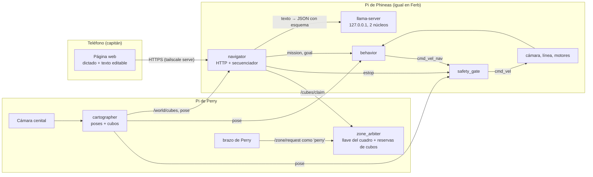

# Plan de integración: arquitectura híbrida y órdenes en lenguaje natural

Fecha: 2026-10-22. Alcance: Phineas y Ferb (mismo código), con Perry como coordinador y cámara cenital.
Este documento es el plan; las tareas con criterio de aceptación salen de aquí hacia
[team-todo.md](team-todo.md) o hacia `specs/<slug>/` con el flujo SDD.

## 1. Requisitos (versión actualizada)

### Funcionales

| ID | Requisito | Estado en el repo |
|---|---|---|
| RF1 | Explorar la pista sin salir del rectángulo de cinta negra | Implementado (sensor de línea + cerca virtual con pose cenital) |
| RF2 | No chocar con el otro robot | Implementado en `safety_gate` (cono de 120°, 0,40/0,60 m, regla asimétrica de bloqueo) |
| RF3 | Detectar cubos y su color con la cámara a bordo | Implementado; falta calibrar con la cámara real |
| RF4 | **Misión (regla del 2026-10-27, reemplaza "todo menos rojo" del 2026-10-22):** la interfaz da uno o varios colores objetivo y los prohibidos. Suma puntos cada objetivo entregado y resta tocar un prohibido. Solo se capturan objetivos; los demás se pueden mover en la pista, nunca al cuadro. Sin misión, el robot quieto | Implementado: `set_mission`, parámetros `my_colors` / `avoid_colors` (texto separado por comas), `targets:=` / `avoid:=` en el launch, `chase --target --avoid` |
| RF4b | **Movimiento en asterisco (regla del 2026-10-27):** trasladarse en cualquier dirección o girar en el sitio, nunca las dos cosas; sin arcos | Implementado en `safety_gate` y `behavior` |
| RF5 | Los rojos se quedan en la pista: no se capturan y, si uno entra en la pala, se suelta | Nuevo |
| RF6 | Los dos robots no persiguen el mismo cubo | Nuevo (consecuencia de RF4: ahora compiten por los mismos colores) |
| RF7 | Turnos con Perry en la zona de descarga: ni robot ni brazo entran mientras el otro trabaja | Parcial: la llave del cuadro existe; Perry aún no la pide |
| RF8 | Interfaz web ligera en el teléfono: dictado de voz → texto editable → envío al robot | Nuevo |
| RF9 | Un modelo de lenguaje pequeño **en la Pi** convierte la orden en un plan; el robot sigue autónomo sin él | Nuevo |
| RF10 | Parada inmediata desde el teléfono, sin pasar por el modelo de lenguaje | Nuevo |
| RF11 | Una orden se dirige a un solo robot; cada robot sirve su propia interfaz | Nuevo (decisión del 2026-10-22) |

### No funcionales

| ID | Requisito | Cómo se mide |
|---|---|---|
| RNF1 | El modelo de lenguaje no altera los lazos de control: `safety_gate` a 20 Hz y `behavior` a 10 Hz con el modelo generando | Jitter del periodo (p99 < 10 ms) con y sin inferencia |
| RNF2 | El robot arranca y trabaja sin modelo de lenguaje, sin teléfono y sin internet | Prueba con `llama-server` detenido |
| RNF3 | Todo cabe en la Pi 5 de 8 GB y la SD de 64 GB, sin escritorio, administrado por SSH | Presupuesto de la sección 5 |
| RNF4 | Latencia de una orden en lenguaje natural ≤ 15 s (p95); parada ≤ 300 ms | Banco de órdenes (fase 5) |
| RNF5 | Solo los dispositivos del dueño pueden mandar órdenes | La interfaz solo es accesible por la tailnet |
| RNF6 | Cada orden, la salida cruda del modelo, el plan validado y el resultado quedan registrados | `navigator.jsonl` en la Pi |

## 2. La metáfora del barco aplicada al sistema

La analogía del profesor corresponde a la arquitectura de tres capas clásica (3T: Gat, 1998;
controlador reactivo, secuenciador y deliberador), con una diferencia importante: **el modelo de
lenguaje no traza la ruta**. Un modelo de 1-2 mil millones de parámetros es malo en geometría y
aritmética; sí sirve para entender una intención en español. La ruta la calcula código determinista.

| Rol | Pregunta que responde | Componente | Dónde corre | Frecuencia |
|---|---|---|---|---|
| **Capitán** | ¿Qué queremos lograr? | El usuario, por voz o texto | Teléfono | Cuando quiera |
| **Cartógrafo** | ¿Dónde está cada cosa? | `cartographer`: pose de los robots, posición y color de cada cubo, ocupación del cuadro | Pi de Perry (cámara cenital) | 10 Hz |
| **Navegante** | ¿Qué hacer ahora y en qué orden? | `navigator`: (a) intérprete con LLM: orden → misión estructurada; (b) secuenciador determinista: misión + mapa → próximo cubo y reserva | Pi de cada robot | (a) por orden, segundos; (b) 1 Hz y por eventos |
| **Timonero** | ¿Cómo muevo las ruedas ya? | `behavior` (máquina de estados, planificador A*) + `safety_gate` | Pi de cada robot | 10 Hz y 20 Hz |

Reglas que hacen que sea híbrida de verdad y no un LLM al volante:

1. El timonero nunca espera al navegante. Si no hay misión, usa la misión por defecto (RF4).
2. El navegante nunca escribe velocidades. Publica una **misión** y un **objetivo** (cubo reservado
   en coordenadas de mesa); el timonero decide cómo llegar.
3. El LLM nunca produce coordenadas ni parámetros de seguridad: solo valores de un esquema cerrado
   (enumeraciones y enteros acotados). Todo lo que sale de él se valida antes de usarse.
4. `safety_gate` sigue siendo el único nodo que escribe en los motores. Nada de esto lo salta.



## 3. Diseño por componente

### 3.1 Cartógrafo (Pi de Perry)

Se extiende `overhead_localization` en vez de crear otro nodo: ya recibe la imagen cenital y tiene la
homografía píxel → mesa (`core/homography.py`).

- Además de los ArUco, corre `vision.detect_cubes` sobre la imagen cenital (con sus propios rangos
  HSV y áreas) y pasa cada centro por `pixel_to_table`.
- Seguimiento mínimo: asociación al vecino más cercano (≤ 4 cm) entre cuadros para dar a cada cubo un
  `id` estable; un cubo que no se ve en 2 s desaparece del mapa. Los cubos dentro de la huella de un
  robot (tapados por él o en su pala) se marcan `occluded` en vez de borrarse.
- Publica `/world/cubes` (`WorldCubeArray`: id, color, x, y, last_seen, in_zone) a 5-10 Hz y el número
  de cubos dentro del cuadro azul (Perry lo usa para saber cuándo recoger).
- **Viabilidad a comprobar primero:** un cubo de 2 cm visto desde la altura de la cámara cenital debe
  ocupar al menos ~12 × 12 px. A 640 px de ancho para 1,2 m son ~1,9 mm/px → ~10 px: justo. Con
  1280 × 960 sobra. Depende de la cámara y la altura reales (pregunta abierta).

### 3.2 Coordinador (Pi de Perry)

- **Reservas de cubos (RF6):** un `ZoneLease` por `id` de cubo (la clase ya existe y está probada),
  con caducidad corta (15 s) que el navegante renueva mientras persigue el cubo. Servicio nuevo
  `ClaimCube.srv` (`robot`, `cube_id`, `release`) → (`granted`, `holder`). Al entregar o abandonar, se
  libera.
- **Turnos con Perry (RF7): sin código nuevo en el árbitro.** Perry pide `/zone/request` con
  `robot: perry` antes de meter el brazo y la devuelve al terminar. Los robots ya esperan en su punto
  de espera cuando la llave la tiene otro.

### 3.3 Navegante (Pi de cada robot)

Un solo nodo nuevo, `navigator_node`, con su lógica pura en `core/mission.py` (sin ROS, probada con
pytest como el resto de `core/`).

**Misión** (lo único que el LLM puede producir; mensaje `Mission.msg` latched en `/<robot>/mission`):

```json
{
  "action": "collect | pause | resume | go_wait_point | status",
  "colors": ["orange", "yellow", "green", "blue", "purple"],
  "region": "all | north | south | east | west",
  "max_cubes": 0,
  "speed": "slow | normal",
  "reply": "texto corto en español para mostrar al usuario"
}
```

- `colors` siempre se interseca con la política del robot: **rojo nunca** (RF4). Si la orden pide
  rojos, la validación lo rechaza y la interfaz explica por qué.
- `max_cubes = 0` significa sin límite. `speed: slow` escala las velocidades de `behavior` a 0,6; el
  LLM no puede subirlas.
- Misión por defecto al arrancar: `collect`, todos los colores menos rojo, `region: all`.

**Secuenciador determinista** (1 Hz y cuando cambia el mapa, la misión o una reserva):

1. Candidatos: cubos de `/world/cubes` con color de la misión, dentro de la región, fuera del cuadro
   y sin reserva de otro robot.
2. Costo: distancia robot → cubo + distancia cubo → entrada del cuadro (la segunda pesa porque el
   transporte es lento y solo en arco). Se elige el menor y se pide la reserva.
3. Con reserva: publica `/<robot>/goal` (id, x, y). Sin candidatos: no publica objetivo y el timonero
   explora como hoy.
4. Replanifica si el cubo desaparece, pierde la reserva o aparece uno 30 % más barato **solo** cuando
   el robot no lleva cubo (cambiar de idea con el cubo en la pala no ahorra nada).

**Intérprete de órdenes** (en un hilo, para que el nodo siga atendiendo ROS mientras el LLM piensa):

1. **Vía rápida sin LLM:** expresiones regulares para lo frecuente y lo urgente: "para", "alto",
   "detente", "sigue", "continúa", "pausa", "ve a tu punto de espera". Responden en milisegundos.
2. Si no aplica la vía rápida: petición a `llama-server` con el esquema JSON como restricción de
   gramática, un prompt de sistema corto en español con 6-10 ejemplos y un resumen del estado actual
   (estado, si lleva cubo, entregados, cubos visibles por color). Tiempo máximo 20 s.
3. Validación (tipos, enumeraciones, política de colores). Salida inválida o tiempo agotado → la
   misión actual sigue y la interfaz muestra "no entendí, reformula".
4. **Confirmación humana:** la interfaz muestra el plan en palabras ("Recoger solo azules y verdes,
   máximo 3, mitad norte") con botones Ejecutar / Editar. Las órdenes de la vía rápida se ejecutan sin
   confirmar.

**Cuándo se aplica una misión nueva** (puntos seguros): `pause` y la parada, de inmediato. Un cambio de
colores o región con un cubo en la pala espera a que termine `DELIVER` (o a que se pierda el cubo),
para no soltar la llave del cuadro a mitad de la entrega.

### 3.4 Timonero: cambios en `behavior` y `safety_gate`

Cambios pequeños, en `core/` y con pruebas, sin tocar las reglas de seguridad existentes:

| Cambio | Dónde | Motivo |
|---|---|---|
| ~~`my_colors` pasa a ser todo menos rojo~~: reemplazado el 2026-10-27 por la misión (RF4) | `config/*.yaml`, README, docs | RF4 |
| `BehaviorInput` recibe `mission` (colores, pausa, escala de velocidad) y `goal` (x, y o nada) | `core/behavior.py` | Los colores dejan de ser un parámetro fijo |
| En `EXPLORE`, con `goal` y pose: rumbo al objetivo en vez de vagar; al ver el cubo con la cámara pasa a `APPROACH` como hoy | `core/behavior.py` | El navegante decide adónde; la captura sigue siendo reactiva |
| En `EXPLORE`/`APPROACH`: un cubo rojo cerca del frente (cy alto) se trata como obstáculo y se gira | `core/behavior.py` | RF5: con la pala fija, avanzar sobre un rojo lo captura |
| Rojo dentro de la pala (`scoop_color` de otro color): retroceso de `shed_distance` (8 cm) y giro | `core/behavior.py` | RF5. **No necesita excepción nueva en `safety_gate`**: sin cubo propio en la pala, el filtro ya permite la reversa con pose fresca dentro de la pista. Junto a la cinta la cerca virtual la anula y el giro en el sitio expulsa el rojo. Se confirma durante `shed_confirm` (rojo y naranja son tonos vecinos) y en la línea retrocede al menos `line_backoff`. Implementado el 2026-10-22 |
| Tópico `estop` (Bool, latched) que pone la salida en cero mientras esté activo | `safety_gate_node.py` | RF10: la parada vive en el único nodo que escribe en los motores |

Con los dos robots persiguiendo los mismos colores, la competencia por el cuadro aumenta: la llave y
los puntos de espera actuales ya lo resuelven, pero hay que medir cuánto tiempo pasa cada robot
esperando (fase 6).

### 3.5 Interfaz web

- Un solo `index.html` con JavaScript sin frameworks (~150 líneas), servido por `navigator_node` con
  `http.server` de la biblioteca estándar, el mismo patrón que `tools/lab/stream.py`.
- El servidor escucha solo en `127.0.0.1:8080`. Se publica con `tailscale serve --bg 8080`, que da
  `https://phineas.<tailnet>.ts.net` con certificado válido. Así:
  - la Web Speech API funciona (exige contexto seguro, HTTPS);
  - solo los dispositivos de la tailnet pueden mandar órdenes (RNF5), aunque la Wi-Fi del laboratorio
    sea compartida.
- Dictado: `webkitSpeechRecognition` con `lang = "es-419"` y resultados parciales que llenan un
  `<textarea>`; el usuario corrige y pulsa Enviar. En Chrome para Android el audio se transcribe en
  servidores de Google (hay internet en el laboratorio). Si el navegador no tiene la API, el botón del
  micrófono se oculta y queda el dictado del teclado del teléfono, sin código extra.
- Endpoints: `POST /api/interpret` (texto → misión propuesta + resumen), `POST /api/execute` (misión
  confirmada), `POST /api/stop`, `GET /api/status` (consulta cada 1 s: estado, cubo en pala,
  entregados, misión activa, último error). Opcional: `GET /stream` con la cámara del robot, reusando
  `FrameBuffer`.
- Botón de parada grande y siempre visible; llama a `/api/stop`, que publica `estop`.

### 3.6 Modelo de lenguaje en la Pi

- **Motor:** `llama.cpp` (`llama-server`), compilado en la Pi para aarch64. Es el más liviano, tiene
  API compatible con OpenAI en HTTP, restringe la salida con un esquema JSON y reutiliza la caché del
  prompt de sistema. Corre como servicio `systemd` **fuera de ROS**: si se cae, el robot no se entera.
- **Modelo:** no se elige a ojo. Candidatos en GGUF `Q4_K_M` (verificar si hay versiones más nuevas al
  momento de bajar): Qwen2.5-1.5B-Instruct, Qwen3-1.7B (sin modo de razonamiento), Gemma 3 1B,
  Llama 3.2 1B y 3B. Se queda el **más pequeño** que pase el banco de órdenes (fase 5).
- **Banco de órdenes:** 50 órdenes en español venezolano, con su misión esperada, incluidas trampas
  ("trae los rojos", "ve rápido", "ayuda a Ferb", órdenes ambiguas). Criterio: ≥ 90 % de misiones
  correctas campo por campo, 0 % de misiones que violen la política (la validación lo garantiza; el
  banco comprueba que el rechazo se explica bien).
- **Estimación de latencia (a medir):** con 2 hilos en la Pi 5, un modelo de ~1,5B en Q4 genera del
  orden de 5-10 tokens/s; una misión son ~60-80 tokens → 8-15 s. Uno de ~0,5-1B, 3-6 s. El prompt de
  sistema queda en caché; solo se procesa la orden nueva y el resumen de estado (~80 tokens).

## 4. Comunicación entre los tres robots

Todo por ROS 2 (DDS) en el mismo `ROS_DOMAIN_ID`; no se agrega otro bus.

| Quién → quién | Tópico o servicio | Nuevo |
|---|---|---|
| Perry → robots | `/<robot>/pose`, `/world/cubes`, `/zone/occupant` | `/world/cubes` |
| Robot → Perry | `/zone/request`, `/zone/release`, `/cubes/claim` | `/cubes/claim` |
| Brazo de Perry → árbitro | `/zone/request` con `robot: perry` | No (solo usarlo) |
| Robot → robot | `/<robot>/state`, `/<robot>/pose`, `/<robot>/mission` | `/<robot>/mission` |

**Red:** las Wi-Fi universitarias suelen aislar a los clientes o filtrar multicast, y entonces DDS no
descubre a los demás nodos. Recomendación: un enrutador propio para los tres robots (con salida a
internet para el dictado y Tailscale) y `chrony` entre las tres Pi (la pose caduca a los 0,5 s). Si el
descubrimiento sigue fallando, `ROS_STATIC_PEERS` con las IP fijas. Por la red nunca viajan imágenes,
salvo el `/stream` de depuración.

## 5. Presupuesto de recursos de cada Pi 5 (8 GB, SD de 64 GB)

| Recurso | Consumidor | Estimado (a medir en la fase 0) |
|---|---|---|
| RAM | Ubuntu Server 26.04 sin escritorio | ~0,4 GB |
| RAM | 7 nodos de ROS 2 en Python (6 actuales + `navigator`) | ~0,6 GB |
| RAM | `llama-server` + modelo ~1,5B Q4 + contexto de 2048 | ~1,3 GB |
| RAM | **Total** | **< 3 GB de 8**: la memoria no es el cuello de botella |
| CPU | cámara + `cube_detector` (640 × 480 a 15 fps) | ~1 núcleo |
| CPU | `llama-server` mientras genera | 2 núcleos al 100 % durante segundos |
| SD | Ubuntu + ROS 2 `ros-base` + workspace + modelo (~1 GB) | < 15 GB de 64 |

Los riesgos reales son CPU, temperatura y energía, no la RAM:

- **Aislamiento de CPU:** `llama-server` con `--threads 2`, `CPUAffinity=2 3`, `Nice=19`,
  `CPUWeight=10` y `MemoryMax=2G` en su unidad `systemd`. Los nodos de ROS quedan sin fijar y con
  prioridad normal: el planificador del kernel los atiende primero. Se verifica con RNF1.
- **Temperatura:** disipador activo obligatorio. Prueba de 10 min con cámara + inferencia continua:
  la temperatura (`/sys/class/thermal/thermal_zone0/temp`) debe quedar < 80 °C (la Pi baja la
  frecuencia a 85 °C).
- **Energía (riesgo alto):** la batería 2S de 2000 mAh alimenta la Pi y los 4 motores a través de la
  Fusion HAT+. Inferencia + motores arrancando puede producir caídas de tensión y reinicios. Medir los
  avisos de subtensión durante la prueba anterior con los motores en marcha; si aparecen, la Pi pasa a
  un power bank USB-C aparte.
- **Desgaste de la SD:** sin swap en la SD (`zram` de 2 GB en su lugar), `journald` limitado
  (`SystemMaxUse=100M`), registros de ROS en `/tmp` (tmpfs) salvo `navigator.jsonl`, que es pequeño
  y se necesita para el informe.

## 6. Fases, en orden, con criterio de salida

El orden importa: el LLM va **después** de que el timonero funcione en la pista real. Un intérprete
de órdenes sobre un robot que todavía no entrega cubos no demuestra nada.

| Fase | Qué | Criterio de salida | Depende de |
|---|---|---|---|
| 0. Plataforma | ROS 2 Lyrical nativo en las dos Pi (y la de Perry), unidades `systemd` (`robot.launch.py`, `llama-server`), `zram`, `journald`, `chrony`, enrutador propio | `robot.launch.py` en banco (`require_pose:=false require_heartbeat:=false`) arranca solo al encender; temperatura, tensión y uso de CPU medidos con inferencia de prueba | Lo pendiente de [estado-y-proximos-pasos.md](estado-y-proximos-pasos.md) |
| 1. Regla de colores | `my_colors` sin rojo en los dos robots, rojo como obstáculo, soltar un rojo de la pala, `estop` | Pruebas de `core/` nuevas en verde; en Webots, ningún rojo termina en el cuadro en una corrida de 7 min | — |
| 2. Cartógrafo | Cámara cenital montada y calibrada (homografía), cubos en `/world/cubes`, reservas en el árbitro, Perry pide la llave | Pose con < 0,5 s de latencia; posición de cubos con error ≤ 3 cm contra medidas a mano; reservas con pruebas | Cámara cenital (tarea 5) |
| 3. Navegante determinista | `core/mission.py`, `navigator_node` sin LLM, `goal` en `behavior`, misión por defecto | En Webots con 14 cubos: **cubos entregados por minuto** frente a la exploración aleatoria actual (misma semilla, 5 corridas cada una). Es la medida de "más eficiente" | 1 y 2 (en Webots, 2 se emula con la verdad del simulador) |
| 4. Interfaz web sin LLM | `index.html`, endpoints, vía rápida de órdenes, `tailscale serve` | Desde el teléfono: "para" detiene en ≤ 300 ms; "sigue" reanuda; el dictado llena el campo | 3 |
| 5. LLM | `llama-server`, banco de 50 órdenes, prompt, validación, confirmación en la interfaz | ≥ 90 % en el banco con el modelo elegido; latencia p95 ≤ 15 s; RNF1 cumplido con inferencia continua | 0 y 4 |
| 6. Sistema completo | Phineas, Ferb y Perry en la pista real | Corridas de 7 min: entregas, rojos movidos, invasiones de la línea, contactos entre robots, tiempo esperando la llave; registro `navigator.jsonl` para el informe | Todas |

Las fases 1 y 2 pueden avanzar en paralelo (personas distintas). La 3 se desarrolla entera en Webots.

## 7. Pruebas

- `core/mission.py`: validación del esquema, política de colores, vía rápida, elección de cubo y
  replanificación, con el tiempo inyectado como en las pruebas existentes.
- `navigator_node` con un **LLM falso** que devuelve respuestas fijas (incluidas inválidas y tiempo
  agotado): así `colcon test` y Docker siguen sin necesitar el modelo.
- `tools/llm/bench.py`: corre el banco de órdenes contra `llama-server` en la Pi y reporta exactitud
  por campo y latencias p50/p95.
- Medición de jitter: registrar el periodo real de `safety_gate` y `behavior` con y sin inferencia.

## 8. Riesgos

| Riesgo | Impacto | Mitigación |
|---|---|---|
| La cámara cenital no resuelve cubos de 2 cm | Sin mapa no hay navegante determinista | Comprobar en la fase 2 antes de nada; si falla, el navegante usa solo lo que ve la cámara a bordo (sin reservas globales, cada robot toma una mitad de la pista) |
| Subtensión con inferencia + motores | Reinicios de la Pi en plena corrida | Medir en la fase 0; power bank aparte |
| Wi-Fi del laboratorio aísla clientes | Los robots no se ven, se detienen por falta de latido | Enrutador propio |
| El modelo pequeño entiende mal en español | Misiones equivocadas | Esquema cerrado, validación, confirmación humana, vía rápida |
| Los dos robots chocan más al perseguir los mismos colores | Bloqueos y tiempo perdido | Reservas de cubos + regla asimétrica existente; medir en la fase 6 |
| La ventana de la pala ve el piso azul del cuadro como "cubo azul propio" | Durante `DELIVER` puede ocultar un cubo perdido | Ya existía para Ferb; medir con la cámara real si la ventana llega a ver el azul |

## 9. Preguntas abiertas

1. **Rojos:** ¿solo no se capturan, o además no pueden moverse de su sitio? Si no pueden moverse,
   también son obstáculos para el planificador A* del transporte (cambio mayor en `core/planner.py`).
2. **Cámara cenital:** modelo, resolución y altura. Decide si la fase 2 es viable tal como está.
3. **Perry:** ¿quién programa el brazo y en qué repositorio? ¿Cuántos cubos caben en el cuadro antes
   de que Perry tenga que vaciarlo?
4. **Evaluación:** ¿qué va a medir el profesor de la parte híbrida? Si es eficiencia, la métrica de la
   fase 3 es la evidencia; si es la interacción en lenguaje natural, el banco de la fase 5.
5. **Fecha de entrega:** para recortar fases si no alcanza el tiempo (el recorte natural es dejar la
   fase 5 con un solo modelo y sin confirmación).
