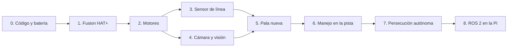

# Plan de pruebas del robot real, por fases

Robot completo (2026-10-20): Raspberry Pi 5 con Ubuntu, SunFounder Fusion HAT+ con los 4 motores ya
conectados, batería Li-ion 7,4 V 2000 mAh, cámara IMX219 funcionando, pala impresa montada y sensor de
línea montado **en el centro del robot** (falta cablearlo).

Este plan dice **qué probar y en qué orden**, cuándo una fase está aprobada y qué anotar. Los comandos
detallados de cada paso están en la [guía de pruebas del laboratorio](guia-pruebas-laboratorio.md).
Cada fase depende de la anterior: si una falla, se resuelve antes de seguir.



Las fases 0 a 7 se hacen con la herramienta del laboratorio (`tools/lab/lab_robot.py`, **sin ROS**).
La fase 8 es para cuando todo lo anterior esté aprobado.

---

## Fase 0. Código, batería y seguridad (antes de encender)

**Objetivo:** que la Pi tenga el código correcto y que la batería sea segura.

1. **Código con soporte para la Fusion HAT+.** Está en la rama `feat/track-v2-fusion-hat`, que todavía
   no está en `main`. Una de dos:
   - integrar el PR de esa rama en `main` antes de ir y en la Pi hacer `git pull` en `main`; o
   - en la Pi: `cd ~/ucab-multirobot && git fetch && git checkout feat/track-v2-fusion-hat && git pull`.

   Con `main` tal como está hoy **los motores no se mueven** (allí el código es para otra placa).
2. Medir la batería con el multímetro: 7,4–8,4 V. Anotar el valor; se usa en todos los pasos con motores
   como `--battery <valor>`.
3. Repasar las [reglas de seguridad](guia-pruebas-laboratorio.md#3-reglas-de-seguridad): conexiones
   con todo apagado, revisar cortos, supervisión del encargado.

**Aprobada si:** `git log -1` en la Pi muestra el último commit de la rama y la batería está en rango.

## Fase 1. Fusion HAT+ (controlador del fabricante)

**Objetivo:** que la Pi vea la placa y que su librería de Python cargue.

Seguir la [sección 4.3 de la guía](guia-pruebas-laboratorio.md#43-driver-de-la-fusion-hat). En
Ubuntu el instalador del fabricante necesita los *kernel headers*; es lo primero que puede fallar.

Comprobaciones:

```bash
i2cdetect -y 1
```
```bash
python3 -c "from fusion_hat.motor import Motor; print('fusion_hat OK')"
```

**Aprobada si:** `i2cdetect` muestra un dispositivo en la dirección `17` y el segundo comando imprime
`fusion_hat OK`.

**Si falla:** anotar el mensaje exacto y la salida de `uname -a`, `dmesg | grep fusion_hat` y
`lsmod | grep fusion_hat`. Sin esta fase los motores no funcionan: no seguir a la fase 2.

## Fase 2. Motores: qué rueda es cada puerto y en qué sentido gira

**Objetivo:** que `avanzar`, `lateral` y `girar` hagan lo que dicen.

Con el robot **levantado, ruedas en el aire**:

```bash
python3 tools/lab/lab_robot.py motors --battery 8.1
```

La herramienta mueve cada rueda, una por una, adelante y atrás, y anuncia la rueda y el puerto que
*cree* que le corresponden (por ejemplo `rueda fl (M0): adelante`); al final prueba el robot completo
(avanzar, lateral izquierda, girar antihorario). Anotar qué rueda se mueve realmente y en qué sentido. Después ajustar en
`src/mobile_base/config/phineas.yaml` (sección `hat_motor_driver`):

- `fusion_ports`: el puerto de cada rueda, en el orden fl, fr, rl, rr (delantera izquierda, delantera
  derecha, trasera izquierda, trasera derecha). Ejemplo: `[M2, M0, M3, M1]`.
- `fusion_reversed`: `true` en la rueda que gire al revés.

Repetir la prueba hasta que las 4 ruedas coincidan.

**Aprobada si:** cada rueda anunciada es la que gira, hacia adelante en "adelante", y en las pruebas
del robot completo: *avanzar* = las 4 hacia adelante; *lateral izquierda* = fl y rr hacia atrás, fr y rl
hacia adelante; *girar antihorario* = las izquierdas hacia atrás y las derechas hacia adelante.

## Fase 3. Sensor de línea

**Objetivo:** cablear el sensor sin riesgo y que distinga blanco de cinta negra.

### 3.1 Conexión (con la Pi apagada y la batería desconectada)

| Pin del módulo | Pin de la Pi (numeración física del conector de 40 pines) |
|---|---|
| VCC | **3,3 V**: pin 1 o pin 17. **No usar 5 V**: los GPIO de la Pi son de 3,3 V y una salida de 5 V puede dañarlos |
| GND | GND: pin 30 (justo al lado del 29) |
| DO (salida digital) | **GPIO5: pin 29** (la Fusion HAT+ no lo usa) |

Los módulos tipo TCRT5000 suelen aceptar 3,3–5 V; confirmarlo en el del equipo. Si la Fusion HAT+ tapa
el conector, usar el conector de pines que la placa repite arriba (mismos números).

### 3.2 Prueba

```bash
python3 tools/lab/lab_robot.py line
```

Con el robot apoyado sobre la pista, pasar el sensor por blanco y por cinta negra.

**Aprobada si:** dice `blanco` sobre el tablero y `NEGRO (linea)` sobre la cinta, y **también sobre el
cuadro azul** anotar qué dice (el azul puede leerse como negro o como blanco; hay que saberlo).

**Si está invertido:** cambiar `active_level` en `line_sensor` del YAML. **Si nunca cambia:** ajustar el
potenciómetro del módulo y revisar el pin 29.

### 3.3 Decisión: el sensor en el centro del robot

En el centro, el sensor ve la cinta cuando **el centro del robot** ya está sobre ella: para entonces el
frente del cuerpo (≈9,5 cm) y la pala ya la pasaron. Todo el software asume el sensor adelante (7,5 cm del
centro). Opciones:

1. **Moverlo al frente**, detrás de la pala (recomendado): el robot frena antes de pasar la cinta.
2. **Dejarlo en el centro:** en estas pruebas sin cámara cenital el robot va a pasar la cinta unos 10 cm
   antes de girar. Hay que avisarme para ajustar el software a esa posición.

Anotar la posición final (distancia del sensor al centro del robot).

## Fase 4. Cámara y visión

**Objetivo:** confirmar que se detectan los cubos de 2 cm de los 6 colores y el cuadro azul, y guardar
imágenes para calibrar.

```bash
python3 tools/lab/lab_robot.py camera --save-every 5
```

Ver el video en `http://IP-DE-LA-PI:8080/`. Guarda una imagen cada 5 s en la carpeta `capturas/`.

| Prueba | Cómo | Aprobada si |
|---|---|---|
| Colores | Un cubo de cada color a 20, 40 y 60 cm delante del robot | Cada uno con su nombre correcto; anotar `cy` y área (px) |
| Rojo vs. morado | Los dos juntos | No se confunden |
| Cuadro azul | Robot frente al cuadro, a 30 cm y a 10 cm | La consola dice `cuadro azul (cx …)` y el video lo marca con una cruz |
| Cubo azul vs. cuadro | Un cubo azul sobre el blanco, lejos del cuadro | Aparece como cubo `blue`, **no** como cuadro |
| Falsos positivos | Tablero vacío y cinta | Sin recuadros de cubos |

Anotar los fps. **Enviarme la carpeta `capturas/`** (o al menos 10 imágenes variadas): con ellas
calibro los umbrales de tamaño (`min_area`, `square_min_area`).

## Fase 5. La pala nueva

**Objetivo:** saber qué hace la pala montada con un cubo de 2 cm. Es un diseño distinto al de la
simulación (placa frontal ancha con los extremos en ángulo, sin bolsillo en U), así que hay que medirlo
antes de confiarle la autonomía.

Con `drive` en el piso (`--max-speed 0.08`) y un cubo de 2 cm delante de la pala:

| Prueba | Teclas | Qué anotar |
|---|---|---|
| Empujar recto 50 cm | `w` | ¿El cubo se queda frente a la pala o se desliza a un costado? |
| Arco con el cubo | `u` y `o` (arco a la izquierda / derecha) | ¿Lo conserva? ¿Con qué giro lo pierde? |
| Giro en el sitio | `q` / `e` | ¿Lo pierde? (en la simulación con la pala fija, sí) |
| Retroceder | `s` | ¿El cubo se queda en su lugar? (así se entrega) |

Y con `camera` abierto: poner el cubo **en el punto de la pala donde queda empujado** y anotar su `cy`
y si cae dentro del rectángulo gris (la "ventana de la pala"). Luego ponerlo a la distancia donde la
pala empieza a tomarlo y anotar ese `cy` (será el `capture_cy`).

**Aprobada si:** se sabe en qué movimientos la pala conserva el cubo y dónde se ve el cubo en la imagen.
Con esto ajusto `capture_cy` y la ventana de la pala en el YAML.

## Fase 6. Manejo en la pista

```bash
python3 tools/lab/lab_robot.py drive --battery 8.1 --max-speed 0.08
```

| Prueba | Aprobada si |
|---|---|
| Cada tecla mueve en la dirección indicada | Sí |
| Avanzar 1 m en línea recta | Anotar cuánto se desvía de lado (cm) |
| Girar 360° en el sitio (`q`) | Anotar cuánto tarda |

La desviación y el tiempo de giro sirven para ajustar la cinemática si hace falta.

## Fase 7. Persecución autónoma

```bash
python3 tools/lab/lab_robot.py chase --battery 8.1 --max-speed 0.08 --capture-cy <valor de la fase 5>
```

El robot explora, gira al ver la línea, se acerca a un cubo de su color y se detiene al llegarle a la
pala. Repetir 5 veces con el cubo en lugares distintos (Ferb: `--robot ferb`).

**Aprobada si:** al menos 4 de 5 veces llega al cubo y se detiene con el cubo frente a la pala, sin
salirse de la pista e ignorando los cubos de los otros colores y el cuadro azul.

## Fase 8. ROS 2 en la Pi (cuando las fases 0–7 estén aprobadas)

ROS 2 Jazzy tiene paquetes oficiales para Ubuntu 24.04; la Pi tiene una versión más nueva, así que la
vía prevista es correr ROS 2 Jazzy en un contenedor Docker en la Pi. Pasos, en otra jornada:

1. Instalar Docker en la Pi y levantar un contenedor `ros:jazzy` con acceso a I2C, GPIO, la cámara y la red.
2. Compilar el repositorio dentro del contenedor (`colcon build`).
3. Lanzar los nodos del robot **sin cámara cenital ni coordinador**:
   `ros2 launch bringup robot.launch.py robot:=phineas require_pose:=false require_heartbeat:=false`.
4. Mover el robot publicando en `cmd_vel` y comprobar que el filtro de seguridad frena en la línea.

La entrega en el cuadro necesita la **cámara cenital** (posición de cada robot): queda para cuando esté
decidido si es la de Perry o una dedicada.

---

## Qué traer de vuelta

1. La [tabla de resultados](guia-pruebas-laboratorio.md#7-tabla-de-resultados) llena, más:
   - `fusion_ports` y `fusion_reversed` finales;
   - posición del sensor de línea y qué lee sobre el azul;
   - resultados de la pala (fase 5) y los `cy` medidos;
   - desviación en 1 m y tiempo de giro.
2. La carpeta `capturas/` de la fase 4 y 5.
3. Los cambios a los YAML: `git diff` dentro de `~/ucab-multirobot`.
4. Cualquier mensaje de error, exacto (una foto de la pantalla sirve).
