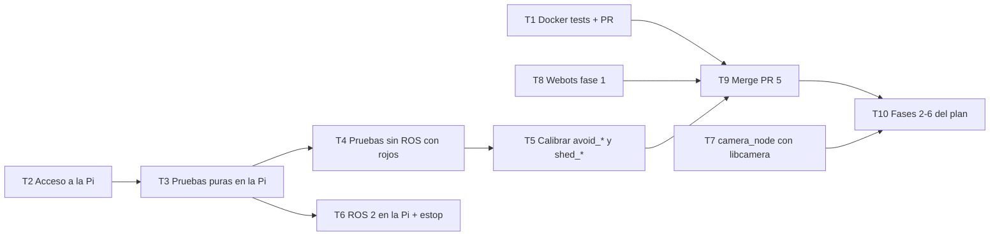

# Traspaso: qué hay que hacer a partir de aquí (para otro agente)

Escrito: 2026-10-23. Destinatario: un agente de código que retoma el trabajo sin haber visto la sesión
anterior. Léelo completo antes de ejecutar nada. Cada tarea dice **quién** la hace (agente o humano),
**qué necesita antes**, **los pasos exactos**, **cuándo está terminada** y **qué no hacer**.

Documentos que complementan este (léelos en este orden si necesitas más contexto):

1. [plan-integracion-hibrida.md](plan-integracion-hibrida.md): el plan general (arquitectura
   cartógrafo/navegante/timonero, LLM en la Pi, interfaz web, fases 0-6). Este traspaso cubre la fase
   1 y la preparación de la fase 0.
2. [guia-siguientes-pasos.md](guia-siguientes-pasos.md): guía del equipo para el robot real (recuperar
   la Pi, pruebas sin ROS, instalar ROS 2, pruebas en banco). Varias tareas de abajo remiten a sus
   partes.
3. [architecture.md](architecture.md): contrato de tópicos y reglas del `safety_gate`.
4. [README.md](../README.md): instalación, simulación, pruebas en Docker.

---

## 0. Reglas de trabajo (no negociables)

### Con el usuario (César)

- **Idioma:** español en todo lo que ve el usuario (mensajes, documentos, PR). Código, comentarios y
  mensajes de commit en inglés, como el resto del repo.
- **Rol:** revisor académico crítico. No felicitar por cosas que solo funcionan; señalar huecos,
  inconsistencias y riesgos con evidencia.
- **Ante cualquier ambigüedad, preguntar.** No asumir. Ejemplo real: "conéctate y dale" no dice qué
  hacer en la Pi; hubo que preguntar.
- **Nunca escribir contraseñas.** Ni la del SSH de la Pi, aunque el usuario la dé en el chat. El
  acceso es por llave (`~/.ssh/id_ed25519`); si la llave no está instalada en la Pi, el usuario la
  instala él mismo (comando en la tarea T2).
- **Configuración del sistema del usuario:** no cambiarla (adaptadores de red, Throne/sing-box,
  firewall). Dar el comando exacto y que el usuario lo ejecute.
- **El robot se mueve:** antes de cualquier comando que mueva motores (`motors`, `drive`, `chase`,
  `robot.launch.py` sin `dry_run`), confirmar con el usuario que hay alguien junto al robot, con la
  batería a mano o las ruedas en el aire.
- **Commits y PR:** solo cuando el usuario lo pide. Ramas `feat/...` o `fix/...`, PR hacia `main`. Nunca
  hacer *merge* del PR sin que el usuario lo diga.

### Con el código

- `safety_gate` es el **único** nodo que escribe en los motores (`cmd_vel`). Nada nuevo puede saltarlo.
- Toda lógica nueva va en `src/mobile_base/mobile_base/core/` (Python puro, sin `rclpy`, OpenCV ni
  `lgpio`, con el tiempo como argumento) y lleva su prueba en `src/mobile_base/test/`.
- Todo parámetro nuevo de `BehaviorParams` o `SafetyParams` va también en `config/phineas.yaml` **y** en
  `config/ferb.yaml`: `test_config.py` falla si falta (ROS 2 ignora en silencio las claves no
  declaradas).
- Mensajes de commit: `tipo(área): qué cambió` en inglés (`feat(behavior): ...`, `fix(safety): ...`,
  `docs: ...`). Terminar con la línea de coautoría que indique el entorno.
- Antes de abrir o actualizar un PR: `powershell -File scripts/test_in_docker.ps1` debe terminar en
  `all checks passed`.

---

## 1. Estado al 2026-10-23 (verificado)

### Repositorio

- Remoto: `https://github.com/alejandrovielma/ucab-multirobot` (rama por defecto `main`).
- Rama de trabajo: **`feat/not-red-rule`**, con `main` ya fusionada (commit de *merge* `bf8b2a2`;
  `main` estaba en `09f6bf2`).
- PR abierto: **alejandrovielma/ucab-multirobot#5**, "feat: both robots collect every color but red;
  estop in the gate". Sin conflictos. **GitHub no tiene CI**: el PR no corre pruebas solo.
- Archivo sin seguimiento `tools/lab/verificar_camara.py`: **no es de esta tarea y no se debe
  commitear** sin preguntar al usuario. Es probable que el commit `32fede2` de `main` (comprobación de
  cámara en `tools/lab/hardware.py`) lo haya reemplazado; preguntarle si se puede borrar.

### Qué hizo la fase 1 (ya en el PR)

Regla nueva desde el 2026-10-22: **Phineas y Ferb empujan al cuadro todos los cubos que no son rojos;
los rojos se quedan en la pista.**

| Cambio | Archivo | Detalle |
|---|---|---|
| Colores | `config/phineas.yaml`, `config/ferb.yaml`, `core/colors.py`, README | `my_colors: [orange, yellow, green, blue, purple]` en los dos |
| Rojo en el camino (explorando) | `core/behavior.py` `_explore`, `_blocking` | Cubo de otro color con `cy_norm > avoid_cy` (0,45) y `abs(cx_norm) < avoid_cx` (0,3): gira en el sitio alejándose (`wz = copysign(turn_speed, cx)`). Máximo `avoid_timeout` (3 s); después lo ignora `skip_time` (3 s) para no girar sin fin si el "cubo" gira con el robot |
| Rojo tapando el objetivo | `core/behavior.py` `_approach` | Si el rojo en el camino está más cerca (`cy` mayor) que el objetivo, omite el objetivo `skip_time` y vuelve a `EXPLORE` |
| Rojo dentro de la pala | `core/behavior.py` `step` | `scoop_color` de otro color durante `shed_confirm` (0,3 s) en `EXPLORE`/`APPROACH`/`CAPTURE`: retrocede `shed_distance` (0,08 m; al menos `line_backoff` si hay línea) y gira. Reutiliza `_start_line_turn(now, pose, backoff)` |
| Parada de emergencia | `core/safety.py`, `nodes/safety_gate_node.py` | `estop` (std_msgs/Bool, relativo al namespace: `/phineas/estop`), QoS transient local (`ZONE_OCCUPANT_QOS`), se mantiene hasta un `false`. Regla 0 del filtro. Cancela un escape de bloqueo y reinicia su temporizador |
| Documentación | `docs/architecture.md`, `docs/plan-integracion-hibrida.md` | Regla 0, tópico `estop`, tabla de la fase 1 |

Decisión de diseño importante: **soltar un rojo no necesitó una excepción nueva de reversa** en
`safety_gate`. Sin cubo propio en la pala (`carrying = false`) el filtro ya permite retroceder con pose
fresca dentro de la pista. Con `require_pose: true` (los dos YAML) y sin pose, el filtro detiene el
robot. Junto a la cinta, la cerca virtual anula la reversa y el giro en el sitio suele expulsar el cubo.

### Pruebas

| Qué | Resultado | Cómo se corrió |
|---|---|---|
| `src/mobile_base/test` | **239 en verde** (tras fusionar `main`) | pytest local en Windows con un venv (ver T1) |
| `src/coordinator/test`, `src/overhead_localization/test` | **11 en verde** | igual |
| `tools/lab/test_lab.py` | **no corre en Windows** (`termios` no existe); no es por este cambio | — |
| `scripts/test_in_docker.ps1` (build de ROS, `colcon test`, arranque de `robot.launch.py`) | **NO CORRIDO** | 1.º: Docker Desktop aún arrancando; 2.º: descarga de `ros:lyrical-ros-base` cortada (`short read ... unexpected EOF`); 3.º: el usuario lo detuvo |
| Webots | **NO CORRIDO** | — |
| Robot real | **NO CORRIDO** | La Pi no responde (ver abajo) |

### Acceso a la Pi de Phineas: NO hay conexión

Datos medidos desde la PC del usuario (Windows 11):

- Wi-Fi de la PC: `10.76.16.42/24`, puerta de enlace `10.76.16.254`.
- IP de la Pi según el usuario: `10.68.17.47`; según `guia-siguientes-pasos.md`: `10.68.17.41`.
  **Ninguna responde** (`ssh ... port 22: Connection timed out`, ping sin respuesta).
- La puerta de enlace de la subred de la Pi, `10.68.17.254`, **sí responde** al ping.
- El usuario enruta su tráfico con **Throne (sing-box) en modo TUN** (adaptador `throne-tun`) porque el
  proxy de la universidad bloquea Claude. **No puede apagarlo.** Throne deja `10.0.0.0/8` fuera del
  túnel (sale por la Wi-Fi), así que el túnel no parece ser la causa: lo más probable es que la Pi esté
  apagada o colgada (la guía sospecha batería baja), que tenga otra IP, o que la red aísle clientes.
- Hay un **cable Ethernet directo** PC ↔ Pi: en la PC es el adaptador `Ethernet 2` (Realtek USB GbE,
  `ifIndex 18`, enlace a 1 Gbps), con solo `169.254.59.65` y **IPv6 desactivado** en ese adaptador.
  La Pi no aparece como vecina. Ubuntu Server no tiene IPv4 en `eth0` sin DHCP, pero sí una dirección
  IPv6 de enlace local (`fe80::...`), que la PC no ve mientras su IPv6 esté apagado. Se le pidió al
  usuario activarlo (comando en T2); a la fecha seguía en `False`.
- Tailscale está instalado en la PC pero **desconectado** (el adaptador tiene `169.254.x`).
- La PC tiene la llave `C:\Users\cesar\.ssh\id_ed25519.pub`. No se sabe si ya está en la Pi.

---

## 2. Tareas, en orden

Resumen y dependencias:



T1, T2 y T8 no dependen entre sí: se pueden empezar en cualquier orden.

---

### T1. Correr las pruebas de Docker y dejar el resultado en el PR #5

- **Quién:** agente. **Necesita:** Docker Desktop encendido **y terminado de arrancar**.
- **Pasos:**
  1. Comprobar el motor: `docker version --format '{{.Server.Version}}'` debe imprimir una versión (no
     `failed to connect to the docker API`). Si falla, esperar y repetir; no lanzar el script antes.
  2. Bajar la imagen base sola (la descarga se cortó una vez):
     `docker pull ros:lyrical-ros-base`. Si vuelve a dar `short read` o `unexpected EOF`, reintentar;
     si persiste, informar al usuario (es la red o el túnel, no el código).
  3. Desde la raíz del repo, en la rama `feat/not-red-rule`:
     `powershell -File scripts/test_in_docker.ps1` (tarda varios minutos: correrlo en segundo plano y
     guardar la salida en un archivo).
  4. Debe terminar en `all checks passed`. El script compila los 6 paquetes, corre `colcon test`,
     importa cada módulo y arranca `robot.launch.py` de Phineas y Ferb sin hardware.
  5. Si algo falla: leer el error completo, reproducirlo con pytest local si es de `core/`, corregir en
     la misma rama, volver a correr. No tocar pruebas para que pasen sin entender por qué fallan.
  6. Actualizar la sección "Verificación" del PR #5 (no crear un PR nuevo):
     `gh pr view 5 --repo alejandrovielma/ucab-multirobot --json body -q .body > body.md`, editar el
     archivo (cambiar "No se corrió `scripts/test_in_docker.ps1`..." por el resultado real, con el
     número de pruebas) y `gh pr edit 5 --repo alejandrovielma/ucab-multirobot --body-file body.md`.
  7. Hacer `git push` de la rama si hay commits sin subir (`git status -sb` muestra `ahead N`; al
     escribir esto, el *merge* de `main` en la rama no estaba subido). Pedir permiso al usuario para el
     push.
- **Pytest local sin Docker** (más rápido, solo lógica pura). Con `uv` instalado:
  ```bash
  uv venv .venv-tests --python 3.12
  uv pip install --python .venv-tests pytest pyyaml numpy opencv-python-headless
  cd src/mobile_base && ../../.venv-tests/Scripts/python.exe -m pytest -q test
  ```
  No commitear `.venv-tests` (agregarlo a `.git/info/exclude`, no al `.gitignore` del equipo).
- **Terminada si:** `all checks passed` y el PR #5 dice el resultado real.
- **No hacer:** no correr el script con Docker a medio arrancar; no fusionar el PR.

---

### T2. Recuperar el acceso SSH a la Pi de Phineas

- **Quién:** humano (en el robot) + agente (diagnóstico y conexión). **Necesita:** batería cargada.
- **Pasos del humano** (partes de la [guía 1](guia-siguientes-pasos.md#1-recuperar-la-pi)):
  1. Medir la batería con el multímetro; por debajo de ~7 V, cargar antes de seguir.
  2. Reiniciar la Pi: mantener el botón de encendido hasta que se apague el LED, presionarlo una vez.
  3. Con monitor y teclado en la Pi, anotar `hostname -I` (IP de la Wi-Fi) y comprobar que `eth0`
     tiene dirección IPv6 de enlace local: `ip -6 addr show eth0` debe mostrar `fe80::...`.
- **Camino A: por la Wi-Fi** (si el humano da una IP nueva):
  1. Agente: `ssh -o BatchMode=yes -o ConnectTimeout=6 phineas@<IP> hostname`. `BatchMode` impide
     que se pida contraseña: si la llave no está instalada falla con `Permission denied`, y eso está
     bien.
  2. Si da `Connection timed out` aunque la IP sea correcta y `ping <IP>` falle: la red aísla
     clientes. Pasar al camino B o C.
- **Camino B: por el cable Ethernet directo** (no depende de la red ni del túnel):
  1. Humano, en PowerShell **como administrador** (Win + X → Terminal (Admin)):
     ```powershell
     Enable-NetAdapterBinding -Name 'Ethernet 2' -ComponentID ms_tcpip6
     ```
     Comprobar: `Get-NetAdapterBinding -Name 'Ethernet 2' -ComponentID ms_tcpip6` muestra `True`.
  2. Agente, descubrir la Pi en el cable (el `18` es el `ifIndex` de `Ethernet 2`; confirmarlo con
     `Get-NetAdapter -Name 'Ethernet 2'`, puede cambiar):
     ```powershell
     ping -n 3 ff02::1%18
     Get-NetNeighbor -InterfaceIndex 18 -AddressFamily IPv6 | Where-Object { $_.IPAddress -like 'fe80*' }
     ```
     La dirección `fe80::...` que no es la de la PC es la Pi.
  3. Agente: `ssh -o BatchMode=yes phineas@fe80::XXXX%18 hostname`.
- **Camino C:** hotspot del teléfono para la Pi y la PC (misma subred), o Tailscale en la Pi (el usuario
  inicia sesión en Tailscale en su PC; hoy está desconectado).
- **Instalar la llave** (lo hace el humano, una vez; pide la contraseña de la Pi):
  ```powershell
  type $env:USERPROFILE\.ssh\id_ed25519.pub | ssh phineas@<IP o fe80::XXXX%18> "mkdir -p ~/.ssh && cat >> ~/.ssh/authorized_keys"
  ```
- **Opcional, con permiso del usuario:** entrada en `~/.ssh/config` (`Host phineas`, `HostName`,
  `User phineas`) para no repetir la IP.
- **Terminada si:** `ssh -o BatchMode=yes phineas@<dirección> hostname` imprime el nombre de la Pi.
- **No hacer:** no escribir la contraseña; no cambiar la configuración de red ni de Throne; no
  desconectar la batería con la Pi encendida salvo que el botón no responda (riesgo para la SD).

---

### T3. Traer el código a la Pi y correr las pruebas puras allí

- **Quién:** agente por SSH. **Necesita:** T2. Nada se mueve en esta tarea.
- **Pasos:**
  1. Procesos colgados de la sesión anterior (la cámara solo admite uno):
     `ps aux | grep lab_robot | grep -v grep`; si hay alguno, `kill <PID>`.
  2. Actualizar: `cd ~/ucab-multirobot && git fetch && git status`. Si hay cambios locales en la Pi,
     **no descartarlos**: mostrárselos al usuario y preguntar.
  3. Probar la rama del PR sin tocar `main` de la Pi: `git switch feat/not-red-rule && git pull`.
     (Si el PR ya está fusionado, `git switch main && git pull`.)
  4. Comprobar `git log -1 --oneline` (debe ser la punta de la rama en GitHub).
  5. Pruebas: `cd src/mobile_base && python3 -m pytest -q test`. Si falta pytest:
     `sudo apt install -y python3-pytest python3-yaml` (pedir confirmación: es instalar paquetes en la
     Pi del usuario). En la Pi sí corre `tools/lab/test_lab.py`:
     `cd ~/ucab-multirobot && python3 -m pytest -q tools/lab/test_lab.py`.
- **Terminada si:** las mismas 239 pruebas en verde en la Pi (aarch64, Python de Ubuntu 26.04) y
  `test_lab.py` en verde. Reportar los números exactos.
- **No hacer:** no `git reset --hard` ni `git checkout -- .` en la Pi; no `apt upgrade` (puede romper
  el overlay de la Fusion HAT+, ver guía 3.3).

---

### T4. Pruebas sin ROS de la regla del rojo en la pista real

- **Quién:** humano en el robot; el agente puede lanzar los comandos por SSH **solo con confirmación
  del usuario para cada uno** (el robot se mueve). **Necesita:** T3, cubos de todos los colores
  incluidos rojos, batería llena.
- **Contexto clave:** `tools/lab/lab_robot.py chase` construye la `BehaviorFSM` desde
  `config/phineas.yaml`, así que **ya usa la regla nueva** (persigue todo menos el rojo y esquiva rojos
  en el camino). Pero `chase` **no pasa `scoop_color`** a la FSM (`BehaviorInput(now, cubes,
  line_front)`), así que **el retroceso para soltar un rojo de la pala no se ejecuta en `chase`**.
  Opciones: (a) probar solo la evasión con `chase`; (b) agregar a `mode_chase` el cálculo de
  `vision.scoop_content(frame, params)` y pasarlo como `scoop_color` (cambio pequeño en
  `tools/lab/lab_robot.py`, con su prueba en `test_lab.py`). Preguntar al usuario cuál prefiere antes
  de programar (b).
- **Pasos** (siempre con `2>&1 | tee <nombre>.log`, `--max-speed 0.08`, `--battery <V medido>`):
  1. **Evasión de un rojo:** un rojo solo en la pista, a 40 cm al frente del robot, centrado.
     `python3 tools/lab/lab_robot.py chase --battery <V> --max-speed 0.08 2>&1 | tee rojo-evasion.log`.
     Esperado: al acercarse (cuando su `cy` pasa de ~0,45) gira en el sitio y no lo empuja. 5 intentos;
     anotar cuántos lo tocan.
  2. **Rojo delante de un cubo propio:** un azul a 50 cm y un rojo a 30 cm en la misma línea. Esperado:
     no empuja el rojo; omite el azul unos segundos y lo busca desde otro ángulo.
  3. **Rojo y naranja juntos:** comprobar con `camera --save-every 5` que el detector no los confunde
     (son tonos vecinos: `red: [0, 8, 169, 179]`, `orange: [9, 18]`). Guardar capturas.
  4. **Rojo en la pala** (solo si se hizo la opción b): poner un rojo dentro de la U a mano y lanzar
     `chase`. Esperado: tras ~0,3 s retrocede 8 cm y gira.
- **Terminada si:** hay `.log` y capturas de los 3 (o 4) casos y una tabla con el resultado por
  intento.
- **No hacer:** no subir `--max-speed` hasta que la evasión funcione; no probar sin alguien junto al
  robot.

---

### T5. Calibrar `avoid_cy`, `avoid_cx`, `shed_distance` y `shed_confirm`

- **Quién:** agente con los datos de T4 y de la parte 2 de la guía. **Necesita:** capturas de la
  cámara montada con su inclinación definitiva (tarea 15 de `team-todo.md`).
- **Cómo:**
  1. `avoid_cy`: en las capturas, el `cy_norm` de un cubo que está a ~5 cm de la boca de la pala (justo
     antes de entrar). Debe ser menor que `capture_cy` (0,62) y dejar tiempo para girar a
     `explore_speed` (0,12 m/s): con 0,3 s de margen, unos 4 cm antes.
  2. `avoid_cx`: el `abs(cx_norm)` de los bordes exteriores de la pala a esa misma distancia, más un
     margen de medio cubo.
  3. `shed_distance`: profundidad real de la U impresa (en Webots es 48 mm) + 2 cm del cubo + 1 cm de
     margen. Medir la pala (tarea 21).
  4. `shed_confirm`: si en las capturas el rojo y el naranja se confunden en fotogramas sueltos, subirlo;
     si no, dejar 0,3 s.
  5. Cambiar los valores en **los dos** YAML (son el mismo cuerpo), correr pytest, commit
     `fix(config): calibrate red-cube avoidance from lab captures`.
- **Terminada si:** los valores salen de medidas con la referencia en el comentario del YAML (fecha y
  cómo se midió), y T4 repetida da 5 de 5 sin tocar el rojo.

---

### T6. ROS 2 Lyrical en la Pi y prueba del `estop`

- **Quién:** agente por SSH, con confirmación del usuario para instalar paquetes y para mover motores.
  **Necesita:** T3; Pi con cargador (la instalación tarda).
- **Pasos:** seguir [guía 3](guia-siguientes-pasos.md#3-instalar-ros-2-lyrical-en-la-pi) (3.1 a 3.4) y
  [guía 4](guia-siguientes-pasos.md#4-pruebas-en-banco-con-ros-robot-levantado-ruedas-en-el-aire)
  (4.1 a 4.3) tal como están. Atención a: `echo $ROS_APT_SOURCE_VERSION` no vacío antes del `dpkg`, y
  después de cualquier reinicio `lsmod | grep fusion_hat` (si sale vacío, repetir el paso del `.dtbo`).
  Luego, **con las ruedas en el aire**, la prueba nueva del `estop`:
  1. Terminal 1: `ros2 launch bringup robot.launch.py robot:=phineas require_pose:=false require_heartbeat:=false`.
  2. Terminal 2: `ros2 topic echo /phineas/cmd_vel` (el robot explora: `linear.x` ≈ 0,12).
  3. Terminal 3: activar la parada (la QoS debe ser transient local o no conecta):
     ```bash
     ros2 topic pub --once --qos-durability transient_local /phineas/estop std_msgs/msg/Bool "{data: true}"
     ```
     Esperado: `cmd_vel` en cero en menos de 100 ms y en el log `safety: stop: emergency stop`.
  4. **Latch:** con la parada activa, reiniciar solo el `safety_gate` (matar su proceso; el launch no lo
     relanza: no tiene `respawn`), y lanzarlo aparte con las mismas anulaciones que usa el launch:
     `ros2 run mobile_base safety_gate --ros-args -r __ns:=/phineas --params-file ~/ucab-multirobot/install/mobile_base/share/mobile_base/config/phineas.yaml -p require_pose:=false -p require_heartbeat:=false`.
     **No funcionará con `--once` si el publicador ya terminó**: para probar el latch, publicar con un
     proceso que siga vivo (`ros2 topic pub --qos-durability transient_local ... "{data: true}"` sin
     `--once`, a 1 Hz). Esperado: el nodo nuevo arranca ya en parada.
  5. Quitar la parada: mismo comando con `{data: false}`. Esperado: vuelve a explorar.
- **Terminada si:** guía 4.1, 4.2 y 4.3 pasan (salvo la cámara, limitación conocida) y los pasos 3-5
  del `estop` se comportan como se espera. Anotar tiempos.
- **Hallazgo a reportar:** el latch del paso 4 depende de que el publicador siga vivo; si el futuro
  `navigator` publica la parada y se cae, la parada vive solo en el `safety_gate` en marcha. Está
  documentado en el código; confirmar en la práctica.

---

### T7. `camera_node` con la cámara CSI (libcamera)

- **Quién:** agente. **Necesita:** acceso a la Pi (T2) para probar.
- **Problema:** `nodes/camera_node.py` usa `cv2.VideoCapture(0)`, que no recibe imágenes de la cámara
  CSI de la Pi 5 en Ubuntu 26.04; `tools/lab/hardware.py` sí, porque usa libcamera (ver cómo abre la
  cámara y cómo detecta `camera in use by PID`, commits `cb95bf3` y `32fede2`). Es la tarea 4 de
  `team-todo.md`.
- **Pasos:** reutilizar la clase de cámara de `tools/lab/hardware.py` (moverla a `mobile_base` si hace
  falta, sin duplicarla), mantener el parámetro `device` para Webots/USB, publicar `bgr8` en
  `camera/image_raw` a `fps`. Prueba unitaria con un doble de la cámara. Probar en la Pi con
  `ros2 topic hz /phineas/camera/image_raw` (≈ 15 Hz).
- **Terminada si:** con `robot.launch.py`, `cube_detector` publica `cubes` con detecciones reales.

---

### T8. Fase 1 en Webots (criterio de aceptación del plan)

- **Quién:** agente o compañero con Webots R2025a en Windows y ROS 2 en WSL (README, "Instalación").
- **Contexto:** el mundo `pista_ucab.wbt` se genera con `tools/sim/generate_track.py` y tiene 2-3 cubos
  por color, **incluidos rojos**. Su comentario aún dice "Phineas red/orange/yellow, Ferb
  green/blue/purple": actualizarlo (solo el comentario).
- **Pasos:**
  1. `ros2 launch bringup sim.launch.py` en la rama del PR.
  2. Otra terminal: `python3 tools/sim_monitor.py --duration 420 --out /tmp/monitor --frames-every 10`.
  3. Al final, contar en la captura cenital: cubos rojos dentro del cuadro (debe ser **0**), entregas
     contadas frente a cubos dentro del cuadro, veces que un robot empujó un rojo (en el monitor:
     transiciones `... cube in the scoop: back off` y `... cube in the way`).
  4. Repetir 3 corridas.
- **Terminada si:** 0 rojos en el cuadro en las 3 corridas de 7 min, sin que ningún robot salga de la
  pista. Si un rojo termina en el cuadro, reproducir el caso en una prueba de `core/` antes de
  corregir.

---

### T9. Fusionar el PR #5

- **Quién:** el usuario decide; el agente lo hace solo si el usuario lo pide explícitamente.
- **Necesita:** T1 en verde. Recomendado también T8 y una ronda de T4.
- **Pasos:** `gh pr merge 5 --repo alejandrovielma/ucab-multirobot --merge` (el repo usa *merge
  commits*: ver `3510a91 Merge pull request #4`). Después, en la Pi: `git switch main && git pull`.

---

### T10. Lo que sigue (fases 2-6 de `plan-integracion-hibrida.md`)

No empezar sin hablarlo con el usuario. Primer paso concreto de cada una:

| Fase | Primer paso | Bloqueo actual |
|---|---|---|
| 0. Plataforma | Medir temperatura y subtensión de la Pi con cámara + carga de CPU de 2 núcleos 10 min (`stress-ng --cpu 2`), con motores en banco | T2 |
| 2. Cartógrafo | Confirmar modelo, resolución y altura de la cámara cenital: un cubo de 2 cm debe ocupar ≥ 12 × 12 px | La cámara cenital no está montada |
| 3. Navegante determinista | `core/mission.py` (validación de misión, elección de cubo) con pruebas; en Webots usar la pose del simulador como mapa | Ninguno (se puede empezar en Webots) |
| 4. Interfaz web sin LLM | `index.html` + `navigator_node` con `http.server`, vía rápida ("para", "sigue"), `estop` | Fase 3 |
| 5. LLM | Banco de 50 órdenes en español con la misión esperada (`tools/llm/`) antes de elegir modelo | Fases 0 y 4 |
| 6. Sistema completo | — | Todas |

Preguntas abiertas que el usuario aún no respondió (sección 9 del plan): si los rojos tampoco pueden
moverse de su sitio (cambia el planificador A*), modelo y altura de la cámara cenital, quién programa a
Perry y cuántos cubos caben en el cuadro, qué evalúa el profesor y la fecha de entrega.

---

## 3. Riesgos y trampas conocidas

| Trampa | Síntoma | Qué hacer |
|---|---|---|
| Throne (sing-box TUN) en la PC | Conexiones raras a la red local | No apagarlo (el proxy de la universidad bloquea Claude). `10.0.0.0/8` ya sale directo por la Wi-Fi; usar el cable (T2 camino B) |
| Docker Desktop a medio arrancar | `failed to connect to the docker API at npipe:////./pipe/dockerDesktopLinuxEngine` | `docker version` hasta que responda |
| Descarga de la imagen base cortada | `short read: expected ... unexpected EOF` | `docker pull ros:lyrical-ros-base` y reintentar |
| `test_lab.py` en Windows | `ModuleNotFoundError: termios` | Correrlo en la Pi o en Docker |
| `apt upgrade` en la Pi | La Fusion HAT+ deja de cargar | `lsmod \| grep fusion_hat`; repetir el `.dtbo` (guía 4.3) |
| `estop` desde la terminal | `ros2 topic pub` sin `--qos-durability transient_local` no conecta (QoS incompatible) | Usar siempre esa opción |
| Rojo y naranja vecinos en tono | Un rojo leído como naranja se lleva al cuadro | Calibrar `hue_ranges` con capturas reales (tarea 3 de `team-todo.md`) |
| Ventana de la pala sobre el piso azul | Durante `DELIVER` puede ver "cubo azul propio" y ocultar un cubo perdido | Medir con la cámara real si la ventana alcanza el azul |
| `avoid_*`, `shed_distance` | Son estimaciones | T5 |
| Ferb | `line_backoff: 0.0`, `blind_reverse: false` hasta medir su sensor | No copiar los de Phineas sin medir |
| SSH cortado con la cámara abierta | `camera in use by PID ...` | `kill <PID>` o `sudo reboot` |

## 4. Qué entregar al usuario al terminar cada tarea

- Qué se hizo y con qué evidencia (salida de pruebas con números, `.log`, capturas).
- Qué **no** se pudo verificar y por qué.
- Si hubo commits: rama, mensajes y si se subieron. Nada de *merge* sin permiso.
