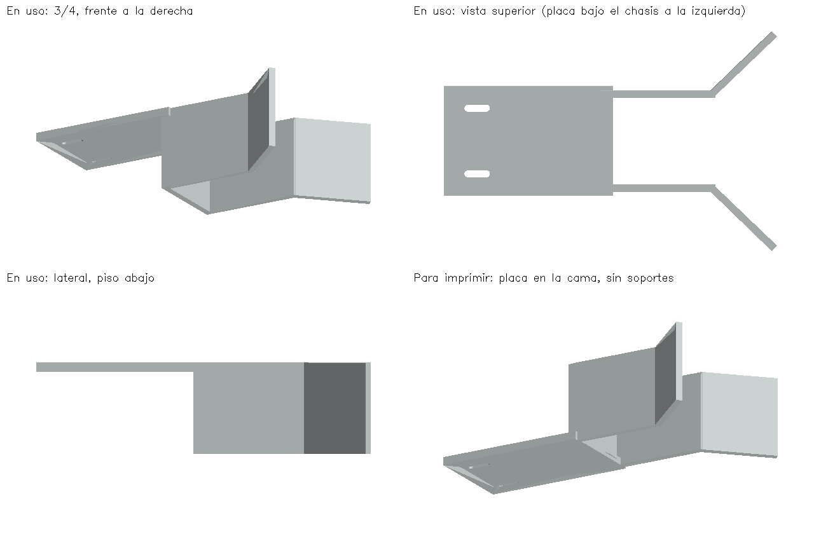

# Pala fija para imprimir (Phineas y Ferb)



| Archivo | Para qué |
|---|---|
| [pala_fija.stl](pala_fija.stl) | Abrir en el laminador (Cura, PrusaSlicer, Bambu Studio) e imprimir. Ya viene orientado para imprimir |
| [pala_fija.scad](pala_fija.scad) | La misma pieza en OpenSCAD (gratuito), para mirarla o retocar números |
| [generar_pala.py](generar_pala.py) | La fuente: todas las medidas están arriba como parámetros; al correrlo se regeneran los dos archivos |

## Qué es

La pala validada en Webots: una U de **40 mm de ancho interior y 48 mm de fondo** (el cubo de 30 mm
queda con 5 mm por lado), paredes de 3 mm que empiezan **2,5 mm sobre el piso** para no arrastrar, y un
embudo a 44° que abre la boca a unos 10 cm. El cubo entra empujado hasta la pared del fondo; al llegar
al cuadro el robot **retrocede y el cubo se queda**, porque la U está abierta adelante.

Todo cuelga de una placa plana de 4 mm que se atornilla **por debajo** de la placa del chasis, con
dos ranuras para tornillos M3 que permiten correrla ±4 mm hacia adelante o atrás.

Medidas de la pieza: 152 × 100 × 41,5 mm, unos 42 cm³ de material macizo (con relleno parcial, menos).

## Antes de imprimir: medir el robot

La pala se diseñó con las medidas del modelo de Webots. **Solo la fijación depende del robot real**:
medir con el robot apoyado en una mesa plana, con las ruedas puestas, y cambiar los parámetros de
`generar_pala.py` si no coinciden.

| Qué medir | Parámetro | Valor actual |
|---|---|---|
| Altura desde la mesa hasta la **cara inferior** de la placa del chasis donde se va a atornillar | `MOUNT_UNDERSIDE_Z` | 44 mm |
| Separación entre los dos agujeros de esa placa que se usarán (izquierda-derecha) | `SLOT_SPACING` | 30 mm |
| Distancia desde el borde delantero de esa placa hasta esos agujeros (hacia atrás, va con signo menos) | `SLOT_CENTER_X` | -20 mm |
| Cuánto puede entrar la placa de la pala bajo el chasis sin chocar con nada (motores, cables, sensor de línea) | `MOUNT_LENGTH` | 35 mm |

Si la placa del chasis no tiene agujeros donde coincidan, se pueden taladrar dos de 3 mm en la placa
del chasis (con todo apagado y desconectado) a la separación de las ranuras.

El **sensor de línea** va debajo, cerca del frente: comprobar que la placa de la pala (que entra 35 mm
bajo el chasis) no lo tape ni lo toque. Si lo hace, reducir `MOUNT_LENGTH` o mover las ranuras.

### Regenerar los archivos después de cambiar medidas

```bash
pip install manifold3d numpy
python hardware/pala/generar_pala.py
```

Imprime el tamaño y el volumen, y vuelve a escribir `pala_fija.stl` y `pala_fija.scad`.

## Impresión

- **Material: PLA gris, negro o blanco.** No usar rojo, naranja, amarillo, verde, azul ni morado: la
  cámara confundiría la pala con un cubo (en Webots, una pala naranja hizo que Phineas persiguiera su
  propia pala).
- **Orientación:** como viene en el STL, con la placa plana sobre la cama y las paredes hacia arriba.
  **No necesita soportes** (verificado en el modelo: no hay caras en el aire).
- Capa de 0,2 mm, al menos 4 perímetros (las paredes de 3 mm quedan casi macizas) y relleno de 25–30 %.
- Las paredes del embudo son delgadas y altas: si la impresora tiende a despegar piezas, usar un *brim*
  de 5 mm.

## Montaje

1. Con el robot **apagado y la batería desconectada**.
2. Pasar dos tornillos M3 por las ranuras y los agujeros del chasis, con arandela y tuerca (o tuerca
   autoblocante) arriba.
3. Antes de apretar, correr la pala hasta que:
   - las paredes queden a 2–3 mm de la mesa (que no rocen; con el robot sobre la mesa);
   - la pala quede centrada (el eje de la U alineado con el centro del robot).
4. Empujar un cubo con la mano hacia dentro de la U: debe entrar por el embudo y llegar a la pared del
   fondo sin trabarse. Luego retroceder el robot con la mano: **el cubo debe quedarse en la mesa**. Si se
   traba, anotar dónde (la U impresa puede salir algo más estrecha que el modelo).

## Después de montarla: calibrar la cámara

Con la pala puesta, correr la herramienta del laboratorio en modo cámara
([tools/lab/README.md](../../tools/lab/README.md)) y:

- poner un cubo en la boca del embudo y anotar su `cy` (será el `capture_cy` del robot real);
- poner un cubo dentro de la U, contra el fondo, y comprobar que la consola dice `pala=<color>` con un
  valor de llenado mayor que 0,30. Si no, el rectángulo gris de la imagen (ventana de la pala) no cae
  sobre el cubo y hay que ajustar `scoop_y_min` / `scoop_y_max` en el YAML.

## Lo que esta pala no hace

Con la pala fija el robot **no puede girar en el sitio llevando un cubo** (el cubo sale despedido; se
comprobó con el teclado y en Webots con 6 formas distintas de U): con cubo solo gira en arco. La
alternativa probada en Webots es una compuerta con servo en la boca de la U (rama `feat/scoop-gate`);
si se decide usarla, la pieza de la puerta se agrega a este diseño.
